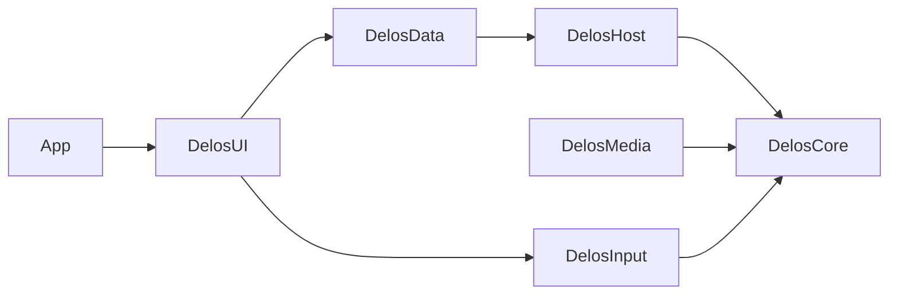

# Architecture

## Purpose

How DELOS for Apple is divided into modules, which way they may depend on each other, and where each part of the app
belongs.

## Modules

The app target (`App/`) only starts the interface. All code is in the Swift package `Packages/DelosKit`:

| Module | Contents | May import SwiftUI |
|---|---|---|
| `DelosUI` | Design tokens, fonts, icons, shaders, components, the focus engine, the screens | Yes |
| `DelosData` | Stored data: hosts, profiles, settings, playtime, artwork | No |
| `DelosHost` | Discovery, pairing, the HTTP(S) client of the host, the client identity, Wake-on-LAN | No |
| `DelosCore` | The C streaming core `delos-common-c` and its Swift wrapper | No |
| `DelosMedia` | Video decoding and rendering, audio | No |
| `DelosInput` | Controllers, keyboard, touch, rumble, motion | No |

Modules that are still empty contain one file that names their phase.

Every module is compiled in the Swift 6 language mode with warnings as errors.

## The stage

Sizes in the specification of DELOS for Android are pixels of a 1920 × 1080 stage. `Stage` scales them to the screen
by the axis with less room; the other axis gets the extra space. Views read the stage from the environment and write
sizes as `stage.px(26)`.

## Focus

On tvOS the system focus engine moves the focus. On iPhone, iPad and Mac a game controller does not drive SwiftUI's
focus, so `MenuInput` (DelosInput) turns the D-pad, the left stick, A, B and the arrow, Return and Escape keys into
commands, and `FocusModel` (DelosUI) moves the focus to the nearest item in the pressed direction (`FocusGeometry`).
`FocusItem` wraps a view for both engines.

## Backgrounds

The animated backgrounds are Metal stitchable shaders in `DelosUI`, ported line by line from the AGSL sources of DELOS
for Android (`shell/ui/BackgroundShaders.kt`). Contour exists so far.

## The host layer (DelosHost)

`DelosHost` speaks the GameStream HTTP protocol of Sunshine, Apollo, Vibepollo and GeForce Experience. It holds no
state: `DelosData` stores `HostRecord` values, and the screens call `HostClient`.

| Part | Type | What it does |
|---|---|---|
| Discovery | `HostDiscovery` | `NWBrowser` for `_nvstream._tcp`; each service is resolved by a short TCP connection to it; events as an `AsyncStream` |
| Typed address | `HostAddress.parse` | IPv4, IPv6 with or without brackets, host names, optional port; the contract table of DELOS for Android (`PcSetupTest`) |
| Requests | `HostClient` | `serverinfo`, `applist`, `appasset`, `launch`, `resume`, `cancel`, `unpair`, pairing; XML read with `XMLParser` |
| Transport | `HTTPTransport` | One HTTP/1.1 GET per Network.framework connection; HTTPS with the pin and the client certificate |
| Pairing | `HostClient.pair` | The PIN handshake of `PairingManager`: AES-128-ECB (CommonCrypto), SHA-256 from server generation 7 and SHA-1 before (CryptoKit), RSA signatures (`SecKey`) |
| Identity | `ClientIdentity`, `ClientIdentityStore` | RSA 2048 key and a self-signed X.509 certificate made on the device, kept in the Keychain |
| Stored host | `HostRecord` | What is known about a host, and the rule for updating it from an answer |
| Wake-on-LAN | `WakeOnLan` | The magic packet to every known address and the broadcast address |

Network.framework instead of URLSession: the pin is a TLS verify block that replaces the system's evaluation
completely, the client certificate is a TLS option, and plain HTTP to a PC by address or name needs no App Transport
Security exception.

### Security rules

These are the findings S-02, S-06 and S-07 of the security review of DELOS for Android, built in from the start.

- **Exclusive pin (S-07).** Pairing pins the certificate the host sent. HTTPS to that host accepts this certificate,
  byte for byte, and nothing else: no system trust store, no host name check. HTTPS is used only with a pin.
- **Unverified answers (S-06).** For a paired host, `serverinfo` goes over HTTPS. If the host shows another
  certificate or no longer knows the client (401), the answer is fetched over plain HTTP and marked `plainHTTP`.
  `HostRecord.updated(with:)` then changes only reachability (online, the address that answered,
  `lastReplyVerified = false`); name, addresses, MAC, ports and the pin stay. Before pairing nothing can be verified,
  so plain answers fill the record; the pin is only ever set by `paired(with:)`. An answer with another `uniqueid`
  is rejected.
- **Host ids (S-02).** A `uniqueid` must be 1 to 64 ASCII letters, digits or hyphens; otherwise the answer is rejected.

### Client identity

`ClientIdentity.generate()` makes an RSA 2048 key (`SecKeyCreateRandomKey`) and a self-signed X.509 v3 certificate
(common name `NVIDIA GameStream Client`, SHA-256 with RSA, valid 20 years, no extensions, as Moonlight makes it). The
certificate is encoded by a small DER writer in the module; no third-party code is used. TLS needs a `SecIdentity`,
which the Security framework only gives for keys in a keychain or from PKCS #12, so the key and certificate are packed
into a PKCS #12 container in memory (PBES2 with AES-256-CBC, HMAC-SHA256 MAC, random throwaway password) and imported
with `kSecImportToMemoryOnly`.

`ClientIdentityStore` keeps the key (PKCS #1), the certificate and the 16-digit client id as one property-list item:
a generic password of the data protection keychain, service `io.github.meitoncz.delos.client-identity`, accessible
after first unlock, this device only (not in backups, not synchronized). An item that cannot be decoded is replaced
by a new identity; a keychain that cannot be read is an error, never "no identity".

### Launch

`launch` and `resume` build the query of `NvHTTP.launchApp` of DELOS for Android, including the quirks for GeForce
Experience. The value of `LiGetLaunchUrlQueryParameters()` from the streaming core is passed in by the caller.

### Info.plist

`NSLocalNetworkUsageDescription` comes from `INFOPLIST_KEY_NSLocalNetworkUsageDescription` in `Config/Shared.xcconfig`.
`NSBonjourServices` is an array, which `INFOPLIST_KEY_*` settings cannot express; it is in `Config/Info.plist`, which
Xcode merges with the generated keys (`INFOPLIST_FILE` next to `GENERATE_INFOPLIST_FILE = YES`).

## Verification

- `swift test` in `Packages/DelosKit`: colors against an independent HSL implementation, focus geometry and model,
  stage scaling, controller stick and key mapping.
- `swift test`, host layer (`Tests/DelosHostTests`), against a fake host on the loopback interface (Network.framework
  listeners, HTTPS with a generated identity that requires a client certificate): `serverinfo` and `applist` parsing
  with the documents of DELOS for Android's tests (Sunshine, Apollo, GeForce Experience in UTF-16), the full pairing
  against an independent implementation of the host side (correct PIN, wrong PIN, forged signature, another client
  pairing, refusals at every step, SHA-1 hosts, Apollo passphrase), pin accepted and rejected, the HTTP fallback,
  invalid host ids, the `HostRecord` update rule, the typed-address table, the Wake-on-LAN packet and its delivery to
  a loopback UDP port, Bonjour discovery of a service published on the Mac (private service type), time-outs and
  cancellation. The same tests pass in the iOS simulator (`xcodebuild test -scheme DelosKit-Package`).
- The generated certificate and PKCS #12 container were checked once with OpenSSL (`x509 -text`, `verify`,
  `pkcs12 -info`, `rsa -check`).
- The built app's `Info.plist` contains `NSLocalNetworkUsageDescription` and `NSBonjourServices` (`plutil -p`).
- A throwaway build of the app in an iOS 27.2 simulator (2026-11-16): `KeychainStorage` stored, reloaded and deleted
  the identity (package tests cannot reach the keychain: they lack the entitlement, error -34018); `HostDiscovery`
  found a real Sunshine PC on the network, and its `serverinfo` was read over plain HTTP. Nothing was paired or
  launched.
- `sh tools/sim.sh iphone|ipad|tv`: the start screen in the simulators.

### Not verified

- Moving the focus with a real game controller on iPhone and iPad (the simulator has no controller); the logic is
  covered by the unit tests only.
- Performance of the Contour shader on a device.
- Pairing, the app list, box art, launch and quit against a real Sunshine, Apollo or Vibepollo host: the protocol is
  tested against the fake host only. The owner pairs the first real PC.
- The Wake-on-LAN broadcast (a BSD socket, as Network.framework cannot broadcast); on iOS it needs the multicast
  networking entitlement, which the app does not have yet, so only the unicast packets go out there.
- The Local Network permission prompt and Bonjour discovery on a device.
