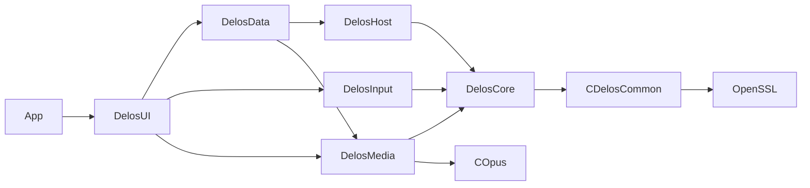

# Architecture

## Purpose

How DELOS for Apple is divided into modules, which way they may depend on each other, and where each part of the app
belongs.

## Modules

The app target (`App/`) only starts the interface. All code is in the Swift package `Packages/DelosKit`:

| Module | Contents | May import SwiftUI |
|---|---|---|
| `DelosUI` | Design tokens, fonts, icons, shaders, components, the focus engine, the screens | Yes |
| `DelosData` | Stored data: hosts, profiles, settings, playtime, artwork, game metadata | No |
| `DelosHost` | Discovery, pairing, the HTTP(S) client of the host, the client identity, Wake-on-LAN | No |
| `DelosCore` | The C streaming core `delos-common-c` (C target `CDelosCommon`) and its Swift wrapper | No |
| `DelosMedia` | Video decoding and rendering, audio; Opus decoding (C target `COpus`) | No |
| `DelosInput` | Controllers, keyboard, touch, rumble, motion | No |

Modules that are still empty contain one file that names their phase.

Every module is compiled in the Swift 6 language mode with warnings as errors.

## The stage

Sizes in the specification of DELOS for Android are pixels of a 1920 × 1080 stage. `Stage` is the port of Android's
`StagePlanner`: it scales the stage to the window by the axis with less room (the other axis gets more stage pixels),
but one stage pixel is never smaller than 0.43 points, the size it has on the AYN Odin 2 Portal where DELOS was
designed. An iPhone in landscape (932 × 430 points) is therefore a 2167 × 1000 stage at the floor, not a smaller copy
of 1920 × 1080; an iPad is a taller stage (1920 × 1440 at 4:3). `StageShape` (wide, standard, tall, compact) names the
layout family, and `Stage.safe` holds the safe area in stage pixels: the window fills the screen, and content anchored
to an edge keeps clear of the safe area itself. Views read the stage from the environment and write sizes as
`stage.px(26)`.

The interface scale (Settings → Appearance, 100 to 130 %) is `Stage.textScale` (Android's `StageMetrics.textScale`):
text and icon sizes are written as `stage.tpx(26)`, which grows with it, while every other size keeps its stage pixels,
so covers, circles and gaps stay as they are. The status bar is zoomed as a whole instead (`ZoomedBar`, the prototype's
CSS zoom): `Stage.zoomed(by:)` makes one stage pixel larger by the scale and the stage as much narrower and lower, with
a text scale of 1 inside, so the bar keeps its proportions and has as many stage pixels across as it really has room
for. The stream screen's text does not follow the scale yet.

## The status bar

`TopBar` (`StatusBar` of DELOS for Android, `StatusBar.swift`) is on every screen but the stream: the brand at the top
left (the start screen leaves it out for the profile chip; on iPhone and iPad the back button comes first), on the
screens of the top navigation the connected PC in a glass pill beside it (green dot while online) and `TopNav` in the
middle, and at the right Wi-Fi, the battery with its percentage and the clock, in a 104 px bar 72 px from the sides.

| Part | Source | Shown |
|---|---|---|
| Wi-Fi | `NWPathMonitor` (`DeviceStatus`) | Wi-Fi while the default network is a satisfied Wi-Fi path, else Wi-Fi off (cellular and Ethernet too, as on Android). iOS gives apps no signal strength, so there are no bars |
| Battery | `UIDevice` battery monitoring; on the Mac IOKit's power sources | The iOS-style battery of Android's `BatteryIndicator`: filled green to the level, red at 20 % and below while not charging, a bolt and a pulse while charging (a Mac on the charger shows the bolt); none where the level is unknown (simulators, Apple TV, a Mac without a battery) |
| Clock | `StatusClock`, every minute | The `Hm` or `hm` pattern of the app's locale (the narrow space before AM / PM becomes a space); Settings → Appearance → Clock: System follows the device's 24-Hour Time (the locale's hour cycle), 12-hour, 24-hour |

A compact stage gets `CompactStatusBar`: 56 px navigation buttons, the PC only as its dot with the PC glyph (the name
is its accessibility label), no wordmark under 1280 bar pixels, and `StatusBarLayout.fit` (Android's `fitStatusBar`)
places the navigation on the bar's middle while 24 px stay to both clusters, else in the middle of the free space,
tightening the inner gaps and last dropping the battery's percentage when even that is too narrow. The clusters are
measured by hidden copies.

## Focus

On iPhone, iPad and Mac every screen that can go back shows a back button at the top left: a touch or mouse user has no
B button, and neither OS has a system back (Android's system back covers this there; on the Mac Escape also goes back).

On tvOS the system focus engine moves the focus. On iPhone, iPad and Mac a game controller does not drive SwiftUI's
focus, so `MenuInput` (DelosInput) turns the D-pad, the left stick, A, B, X, Y, L1, R1, the left menu button (View,
Select, Create: `buttonOptions`), the right menu button (Menu, Start, Options: `buttonMenu`) and the arrow, Return,
Escape and menu keys into commands, and `FocusModel` (DelosUI) moves the focus
to the best item in the pressed direction (`FocusGeometry`, Android's focus finder: a candidate lies beyond the current item by
its far edge, one in the beam, that is overlapping it on the other axis, beats any that is not, and the weight
`13 * major² + minor²` decides; sideways an item outside the beam counts only when it is nearly straight ahead, so Right at
the end of a row never jumps to a button above or a cover below, while Up and Down may lead to an item off to the side, the
navigation being centered above content that is not). A focus on an item that is not there (a library that is still loading
or has no games) falls to the first item in reading order (`FocusModel.focusFirstItem`), never to an arbitrary one. A direction held down repeats as a held key does on
Android (after 500 ms, every 50 ms); the handler gets the number of the repeat (`Navigator.commandRepeat`), which the
settings use to speed up a slider and to stop a held Up at the first row.
`FocusItem` wraps a view for both engines.
A `FocusItem` can name where a direction leads instead of the nearest item (`moves`): the avatar grid continues a
row's end in the next row. Its `tap` is what a touch does when it is not what A does; it gets whether the item had the focus
before the tap (a settings row's first tap only focuses it, the second changes it, `RowTouch`); a tap always focuses the item
first.

## Navigation

`Navigator` (DelosUI) is the screen router: an `@Observable` back stack of `Screen` values (`boot`, `createProfile`,
`start`, `profile`, `pair`, `pairAddress`, `pin`, `home`, `stream`, `settings`), each entry with its own `FocusModel`, so
going back returns the focus to where it was. `DelosRoot` uses `ScreenMotion`: the incoming screen fades in over
280 ms and settles from scale 1.035 over 560 ms; the old screen fades and scales outward to 1.035 over 240 ms,
matching Android's `screenTransition`. Reduced motion keeps only the asymmetric fades. `PolishMotionTests` checks
the timing contract. The root provides the navigator and the one `HostStore` in the environment.

| Call | Use |
|---|---|
| `push(_:focus:)` | Opens a screen above the current one with the focus on an item |
| `back()` | B, Escape or the Menu button of the Siri Remote: pops the top screen; false at the root, where the system handles it |
| `reset(to:focus:)` | Replaces the stack: the first run is over, or starts again after the last profile was deleted |
| `openHome(hostID:)` | A PC's library above the start screen (from the start screen, or once pairing is done: B returns to the start screen) |
| `openStream(hostID:appID:)` | Pushes the stream of an app |
| `openFromNavigation(_:focus:)` | Settings or Profile from the top navigation or the side menu: they take each other's place, so B returns to the screen below them (Android: their `back` is the library) |

While a text field is typed in, `isEditingText` is true and `DelosRoot` gives the controller and keyboard commands to
the field instead of the focus; B or Escape stops typing. The Return that ends typing also reaches `MenuInput` as a key
press, so an accept within 0.3 s after it is ignored (`swallowsAccept`). While `commandCapture` is set (the stream
screen, the settings), every command goes there first. A screen takes the commands and says its hints with its own focus as
the owner (`capture(for:_:)`, `setHints(_:from:)`) and lets go of them only if they are still its own
(`releaseCapture(of:)`, `clearHints(of:)`): a screen that is leaving is removed after the one that comes has appeared, and
must not take the next one's commands away. `ShellRouter` (the routing half of `DelosRoot`, testable without a window) gives
each command to the portal, the side menu, an open layer, the capturing screen or the screen's focus, in that order, and
`ShellRouter.modalFocus` (the portal's, the side menu's, a layer's or `Navigator.screenModal`, the sheet or list of values of
the screen, set with `View.screenModal(_:)`) is what keeps every other item, the top navigation included, from taking the
system focus on tvOS. `NavigationGraphTests` lay the real screens out in a window that is never shown and walk their D-pad
graph; `ShellFlowTests` press the real router's commands through them.

The screens of Android's top navigation (`Screen.main`: the library, Settings, Profile and Devices; `showsNavigation`) show
`TopNav` in the middle of the status bar: Settings, Profile and Devices (Android's order) as round buttons in a glass
capsule; Settings, Profile and Devices take each other's place on the stack; the buttons are items of the shown screen's focus, so Up from the library or the first settings
row reaches them. On those screens and on the start screen (`hasSideMenu`), the left menu button opens the side menu
(`SideMenu`, Android's `SideMenuLayer`): the profile and the connected PC at the top and All settings; it takes every
command while it is open, and B, the menu button or a tap beside it closes it. The quick settings (theme, background, sounds, haptics) are in it; the rows scroll
(`FocusScroll` with edge fades) where the stage is too short, the panel is 680 px wide (glass, `panel` role), docked to the left edge at full height (`SideMenuStyle`: on iPad and Apple TV it is a floating box instead, with continuous 40 px corners and a 32 px gap to the left, top and bottom edges and the safe area; an Apple-only presentation decision, Android keeps its edge panel; iPhone, a narrow iPad window and Mac keep the edge panel) and arrives from
a tenth of its width to its left (`sideEnter`: 560 ms ease-out with a 280 ms fade; it leaves over 240 ms ease-in; only
fading with reduced motion) under the root's scrim (`LayerScrim`: the scrim token, fading in over 420 ms, out over 240 ms),
while the screen behind it blurs by 6 stage pixels (`LayerBackdropBlur`, also behind dialogs; the context menu's scrim only
dims). One plate glides between its rows, as in Settings. The top navigation wraps from the last button to the first; while
the focus moves between two buttons an accent pill glides behind them (`NavPill`: both edges springs, the one in the
direction of travel stiffer) and the focused button's own fill fades in over it. Android has no touch way to the side menu; on the start
screen the profile chip opens the profiles menu (as on Android), so touch reaches Profile and Settings through a PC's
library and its top navigation.

### Who captures the commands

`Navigator.captureCommands(owner:_:)` and `releaseCommands(owner:)` replace the plain `commandCapture` variable: the next screen
shows before the old one's `onDisappear`, which cleared the new screen's capture and hint-bar state, so Y and X were dead on
Home and Artwork after a round trip. A screen releases only what is still its own.

### Layers

`Layers` (DelosUI, the layer half of Android's `ShellState`) holds the one layer above the screen: a context menu or a
dialog. An open layer has a `FocusModel` of its own and takes every command (B, a tap on the scrim; the screen's focus
stays where it was, so the element a menu belongs to keeps its focus look and has the focus again when it closes).
`LayerHost` draws it over the screen with Android's scrim: light under a menu, the scrim token under a dialog.

| Layer | Opens | Port of |
|---|---|---|
| Context menu (`ContextMenuLayer`) | The right menu button, X or the menu key on the focused item, a long press on touch (`FocusItem`'s `menu`, built when it opens), or an item's own action (the profile chip, Switch profile) | `ContextMenuLayer`, `ContextMenuPlacement`: the glass card (Liquid Glass in the card's outline with its caret, `MenuCardShape`), 470 to 640 px as wide as its longest row, a header with the subject's tile, status and facts, rows on one gliding plate (red under a destructive row), submenus in the same card (B or the back chip goes up, the button that opened it closes all). `placeContextMenu` places it beside the element or, for `below`, under or above it; it opens from the caret's tip and shrinks back into it |
| Dialog (`DialogLayer`) | `Layers.openDialog(DialogSpec)` | `DialogLayer`: title, note, fields (the shared `TextPill`), the confirm button and Cancel; the focus starts on the first field, A or a tap types, Return in the last field confirms, and the card moves above the system keyboard |

`ShellActions` builds the menus and dialogs of the screens and runs their actions (Android's `DeviceActions`,
`GameActions` and profile functions). Not ported: the dimming of the covers beside an open game menu, the focus
anchor's growth (the anchor is the element's frame without its focus scale), the hint bar of a compact stage, whose
card keeps 48 px from every edge.

The order of the shell, from below (`DelosRoot` in `StartScreen.swift`, Android's `Shell`): the backdrop, the screen, the top bar
(these blur under a layer's scrim), the scrim, the side menu or layer, the hint bar (crisp and above the layers, as on Android),
the portal, the toasts. The library's filter sheet is a layer of Android's shell, so while it is open the home screen is
raised above the bar and the backdrop and the bar blur like the screen; the Artwork screen's sheet stays under the bar, as
Android's `FilterSheetLayer` is part of its screen.

### Toasts

Messages are Android's console toasts (`Toasts`, `ToastHost`; the pure rules in `ToastLogic`): one card at the top
right, 112 px from the top and 44 from the right, in the color of its kind (`ToastKind`: information, success, warning,
error, Undo; read from the icon unless the caller names it). A newer toast replaces the shown one, which leaves at once
while the new one enters 120 ms later (`ToastStageLogic`); there is never a queue. A toast stays 4.5 s, one with an
action 10 s; the gold line along its bottom edge drains with the time left. Y or a tap runs the action (Undo after
deleting a profile) and squeezes the chip first. The motion is a function of one clock that runs only while a toast
is shown (`TimelineView`): the spring from the right, the icon's pop, the rising text, the halo, one light sweep; with
reduced motion only the fades remain.

Each new toast posts one `AccessibilityNotification.Announcement`, using the same localized description as its
accessibility label, including Undo when offered. `ToastAnnouncement` assigns high speech priority to errors and low
priority to ordinary messages; animation ticks never repost it. Actual VoiceOver speech/interrupt ordering on physical
devices is not verified. The card receives a stage zoomed by the interface scale, so its geometry, text-width cap,
glyphs, action chip and shadows all grow together while the outer screen-edge insets stay fixed.

### Connecting to a PC: the portal

`ShellActions.connect(_:)` (`ShellDeviceActions.connect` of Android's DeviceFlows.kt) runs `ConnectFlow`, a state machine
(`ConnectFlow.Phase`: starting, waking, waiting, connecting, arriving) behind two protocols so the tests drive it with a
fake clock (`ConnectClock`) and a fake network (`ConnectEnvironment`; `AppConnectEnvironment` is the one on `HostStore`):

| Step | What happens |
|---|---|
| Press | OPEN cue; nothing if a portal is already up |
| PC not online | `HostStore.wake` sends the packet; the portal says "Waking up <PC>" · "Wake-up signal sent · B cancels". A PC without a MAC address (or a packet that did not go) gets "Waiting for <PC>" · "Turn the PC on · B cancels" instead, and is waited for just the same |
| Waiting | The PC is asked again at once and every 3 s (`HostStore.refresh`; discovery finds it too) for at most 120 s. B, a tap or a click cancels without a word (BACK cue). After 120 s: ERROR cue and the toast "<PC> did not wake up"; pressing the PC again is the retry |
| Connecting | "Connecting to <PC>" · "Vibepollo · paired" (not cancellable) for at least 2.1 s (0.6 s with reduced motion) while the PC's apps load, for at most 5 s |
| Arrival | SELECT cue, the burst (flash and the orb flying at the viewer), the library opens 380 ms later through the usual screen transition, the burst ends 500 ms after that |

`PortalOverlay` is the port of Android's `PortalOverlay`: the screen behind blurs (22 stage px, `PortalBackdropBlur`), a
radial scrim, four rings 0.35 s apart every 2.2 s (main, second, main, third color) around a 220 px orb with the state's
icon, the PC's name in Unbounded 36 and the note in Figtree 24. The geometry and timing are `PortalLook`. While it is up
`DelosRoot` gives it the modal focus and every command: only B passes (on tvOS the Menu button, through a focus sink).
Android has no way to cancel without a B; here a tap or a click on a portal that can be cancelled does it too.

## Video formats

`DelosMedia` turns what the host sends into what VideoToolbox decodes, without FFmpeg:

| Codec | Stream from the host | Format description | Sample data |
|---|---|---|---|
| H.264 | Annex B NAL units | from SPS and PPS | length-prefixed NAL units without parameter sets |
| HEVC | Annex B NAL units | from VPS, SPS and PPS | the same |
| AV1 | low-overhead OBUs | from the sequence header: `av1C` record, bit depth, range and color (BT.709, BT.2020 with PQ or HLG) | the OBUs unchanged |

`AV1.parseSequenceHeader` reads the sequence header (AV1 specification, section 5.5) with `BitReader`.

`VideoSamples` keeps the format description of the running stream (replaced when a key frame brings different
parameter sets; the same ones keep it without building it again) and wraps each frame in a sample buffer marked
"display immediately", since the host paces the stream; a frame before the first key frame fails with `needsKeyFrame`,
the signal to ask the host for one. It reads a frame once, in place (`AnnexB.forEachUnit` finds the units as ranges
of the frame, `AV1.sequenceHeader` the sequence header), and writes it once, into the sample's own block.
`VideoRenderer` is the renderer interface; `DisplayLayerRenderer` shows the samples through
`AVSampleBufferDisplayLayer` (decision L4, the default) and `MetalRenderer` decodes them itself (see
[The Metal renderer](#the-metal-renderer)).

## Frame pacing

`FramePacer` (DelosMedia) times the frames on screen. With Lowest latency each frame is shown as soon as it is decoded,
so the network's jitter shows as uneven motion: on a 120 Hz screen a frame that arrives a little late misses its
refresh. Balanced (the default on Apple, unlike Android's Lowest latency, after the owner's test on the iPad Pro M5)
holds a frame up to one frame interval and Smoothest up to two; frames are shown at their arrival plus that buffer,
never sooner than 0.9 of a frame after the previous one (the slack follows the host's clock), and a backlog beyond the
buffer starts the schedule again instead of carrying delay. `DisplayLayerRenderer` gives each sample that time on a
timebase that follows the host clock; the layer shows it at the first refresh at or after it. Settings → Stream →
Video frame pacing offers these modes plus Balanced with FPS limit, Warp Drive and Warp 2. The cap follows Android's
near-refresh rules in both the launch request and core configuration; Warp requests 2x/4x the selected host FPS and
uses immediate presentation, not interpolation. Nano Pacer is not offered without a genuine decoded-frame queue.
See [Decoder equivalents](DECODER_EQUIVALENTS.md) for the verified public API boundary, platform differences and
unverified hardware behavior; no private options are applied to the display layer's internal decoder.

## The Metal renderer

The second path of decision L4 (issues #9 and #12; it also prepares #11 HDR and #13 PyroWave, which need to draw
themselves). `MetalRenderer` is a `VideoRenderer` that takes the same compressed `CMSampleBuffer`s as the display layer,
so `VideoOutput` and `VideoSamples` are unchanged:

| Part | What it does |
|---|---|
| `VideoDecoder` | A `VTDecompressionSession`: hardware decoding where the device has it (not required, so the simulator falls back to software), `RealTime`, asynchronous, one frame at a time in arrival order (no B-frames). It outputs Metal-compatible, IOSurface-backed two-plane 4:2:0 buffers, 8 or 10 bits, video or full range, and measures the time from submit to output. A new format description (new parameter sets, another resolution) builds a new session; an error or an invalidated session (the app was in the background) makes the renderer refuse non-key frames until the next key frame, which `VideoOutput` turns into an IDR request |
| `FrameQueue` | The decoded pictures wait here (at most four; a newer one pushes the oldest out). Each gets the time `FramePacer` gives it, the same three modes as the display layer. At each refresh the queue hands out the oldest frame that is due (a frame is due within half a refresh before its time, so it is shown at the refresh nearest to it); when more than one frame would stay due behind it, it skips ahead and the skipped frames count as dropped. In Lowest latency no frame may stay behind, so the newest due frame wins. A struct that takes times as arguments: a fake clock tests it |
| `CAMetalDisplayLink` | Calls back once per refresh with the drawable and the time its picture appears (`targetPresentationTimestamp`), from a thread of its own (the main thread is busy with the interface), at the screen's highest refresh rate. It exists on iOS and tvOS 17 and on macOS 14, so the Mac needs no `CADisplayLink` variant. A refresh without a frame draws nothing and the layer keeps the last picture; the last picture is drawn again when the layer's size changed |
| `MetalFrameDrawer` | The pixel buffer's planes become textures through a `CVMetalTextureCache` (no copy), `VideoShaders.metal` converts Y'CbCr to RGB and the picture is fitted into the drawable on black. `ColorConversion` reads range and bit depth from the pixel format and the matrix and transfer function from the buffer's attachments; BT.601, BT.709 and BT.2020 matrices, limited and full range, 8 and 10 bits. The transfer function stays as encoded and the layer is tagged with the matching colour space (BT.709, BT.2020, PQ, HLG): tone mapping and linearising for HDR start in the shader, where `VideoUniforms.transfer` is already passed |
| `MetalPipeline` | The three of them without the layer and the display link: the core's thread enqueues, VideoToolbox's delivers pictures, the display link's thread draws, behind one short lock. The replay tests drive it with a virtual clock and virtual refreshes |

For an observed PQ or HLG picture, `LayerRetagger` uses an `rgba16Float` drawable and enables the Metal layer's
extended dynamic range with the matching BT.2100 transfer tag; returning to SDR restores `bgra8Unorm` and turns EDR
off. The shader keeps the encoded transfer values: applying an EOTF again under a PQ/HLG layer tag would transform
them twice. `HDRRenderingTests` checks this layer configuration and actual offscreen 10-bit BT.2020 PQ/HLG drawing
against the CPU reference in a floating-point texture.

HDR streaming (issue #11) joins the pieces. **Offer**: `HardwareProbe` creates a hardware-required `VTDecompressionSession`
from generated 256 x 256 HEVC Main10 parameter sets and an AV1 Main 10 sequence header (`VTIsHardwareDecodeSupported` is
per codec and proves no profile); `DecoderSupport.device` adds `hevcMain10` / `av1Main10` only when the session exists.
`HDRDisplay` says whether the display shows HDR (iOS: potential EDR headroom above 1 or an HDR mode; Mac: the screen's
potential EDR value; tvOS: the system's HDR modes). Settings → Stream shows Android's "Enable HDR" row (`checkbox_enable_hdr`,
also an app override) only with both, as Android hides it without an HDR10 display or a Main10 decoder; its stored value
never changes the request on a device without them. `StreamPlan` then adds HEVC Main10 (HDR implies HEVC) and, with AV1
chosen, AV1 Main 10 to the formats and sends `hdr: true` in the launch request; the H.264 choice stays SDR. **Metadata**: while
the host's HDR mode is on, each key frame reads `LiGetHdrMetadata` (`DelosCommonGetHdrMetadata`, a flat C copy because Swift
cannot import the anonymous nested structs). `HDRMetadata` makes the 24-byte big-endian mastering display colour volume
(primaries green, blue, red as in the SEI, luminance as 32-bit 1/10000 nit) and the 4-byte content light level;
`VideoSamples` puts them in the format description's `MasteringDisplayColorVolume` / `ContentLightLevelInfo` extensions
(the display layer reads them there), and `VideoDecoder` copies them onto the decoded pictures, from which `LayerRetagger`
makes the Metal layer's `CAEDRMetadata` (HDR10 with the PQ one-unit-is-10,000-nits scale; the plain HLG description for
HLG; not on tvOS). **Depth**: the decoder reads the bit depth from the format (`hvcC` / `av1C`), asks VideoToolbox for P010
output for 10-bit streams and for 8-bit output otherwise, and makes a new session when the depth changes. **Display layer**:
`DisplayLayerRenderer.setHDR` sets `wantsExtendedDynamicRangeContent` while the chosen format is 10-bit (not on tvOS).
Verified by tests only: the pieces with fakes and CPU references; not verified: the look of HDR on an iPad or iPhone
display, the host's real metadata, a real HDR stream.

`RendererChoice` picks the renderer. Metal is the default (owner's decision, 2026-11-17: effects on the live picture such
as the arrival, frame pacing with the display link, the way to PyroWave); where Metal cannot start, the display layer
takes over. The debug switch `-DelosRenderer layer` (a launch argument or a `defaults` value; `metal` names the default;
release builds ignore it) selects the display layer, for comparisons:

    xcrun devicectl device process launch --device <id> --console io.github.meitoncz.delos.debug -DelosRenderer layer

There is no Settings row. Android's row for the same idea, Fast V-Sync (Nano Pacer), says in its help line "MediaCodec
only", which is not true here, and the Android help text cannot be changed on this side. The row follows when the owner
has compared the renderers on the iPad and decided; it would then reuse `pacing_fast_vsync`.

What a stuck-renderer watchdog can sample from either renderer is `VideoRenderer.presentationCounters()`
(`VideoPresentationCounters`: `totalFrames` shown plus dropped, `droppedFrames`, `accumulatedDelaySeconds`). For
`MetalRenderer` the total grows only while the display link runs (the view is in a window and the app is active), so a
watchdog compares it with the frames it submitted over a window of a second or more.

### What was measured without a stream

The replay harness (`MetalReplayTests`) feeds the fixtures' H.264, HEVC and AV1 frames at 120 fps with seeded, jittered
arrival times into `MetalPipeline`: VideoToolbox decodes every frame and Metal draws every refresh's picture (into an
offscreen texture); only the clock and the display's refreshes are virtual, so the result does not depend on the load
of the machine. It shows that the pipeline gives the same frames at the same refreshes as the queue alone, that every
frame is decoded and accounted for as shown or dropped, and that a picture appears.

The display layer's own presentation cannot be observed without a display (a headless layer takes every frame and
reports zero lateness), so the comparison uses `DisplayLayerModel`, the layer as `AVSampleBufferDisplayLayer` documents
it: each frame gets the `FramePacer` time, the layer shows it at the first refresh at or after it, and of several frames
whose times have passed it shows the newest. It is a model, not a measurement of the layer. Over eight phases of the
stream's clock against a 120 Hz display (1200 frames each, 9600 refreshes), 120 fps:

| Jitter, mode | Metal queue: dropped / judder | Layer model: dropped / judder | Delay past its time, Metal / model |
|---|---|---|---|
| ±1 ms, Balanced | 0 / 1 | 288 / 288 | 4.6 / 4.0 ms |
| ±3 ms, Balanced | 0 / 4 | 550 / 552 | 5.9 / 3.9 ms |
| ±4 ms, Balanced | 0 / 5 | 610 / 612 | 6.4 / 3.9 ms |
| ±3 ms, Smoothest | 0 / 4 | 550 / 552 | 2.2 / 3.9 ms |
| ±3 ms, Lowest latency | 1116 / 1115 | 1116 / 1115 | 12.2 / 12.2 ms |
| bursts every 40 frames, Balanced | 248 / 233 | 599 / 367 | 9.5 / 3.9 ms |

Judder is an interval a refresh or more away from the cadence the stream and the display allow. In Lowest latency both
drop a frame whenever the next one is due in the same refresh, which jitter makes frequent: that mode is steady only
on a network without jitter. In the other modes the model drops frames in some phases of the two clocks (a frame whose
time falls on a refresh's edge goes to either side), and because the host's and the display's clocks drift, every
phase comes round: a possible cause of the uneven 120 fps of issue #9, to be tested with a stream, since the layer's real
behaviour is not known. The queue keeps those frames and shows them one refresh apart; the price is up to one refresh of
delay at the unlucky phases (about 2 ms on average in Balanced).

`SyntheticStreamTests` encodes full-size H.264 and HEVC streams with the Mac's hardware encoder (VideoToolbox has no AV1
encoder) and runs them through `VideoDecoder` and `MetalFrameDrawer`. On the development Mac (the M-series chip of
`Mac18,5`, 2026-11-17) the decoder returned 1,500 to 1,600 pictures a second at 1080p and 370 to 390 at 4K when fed as
fast as it takes them, and the GPU drew a picture in 0.07 ms median at 1080p and 0.6 to 0.7 ms at 4K (p95 under 4 ms).
Those are throughput figures of the Mac, far above 120; per-picture times in a burst include waiting behind earlier
pictures and the first 4K pictures include the session's warm-up, so they are not the latency of a live stream. The
iPad's decoder and GPU were not measured.

`MetalFrameDrawer` is tested against a CPU reference of the conversion with buffers in each range and depth, `FrameQueue`
with a fake clock (order, tolerance, backlog, capacity, flush, lateness, peak, a stall that catches up, a stream
faster or slower than the display), `VideoDecoder` with the three fixtures, `RendererChoice` and the layer's size in pixels.

## Stream output

`VideoOutput` and `AudioOutput` (DelosMedia) are the sinks the stream session hands the core. `VideoOutput` runs on the
core's receive thread (direct submit): it copies each decode unit's buffers, which are valid only during the call, into
one Annex B or OBU frame in storage it keeps from frame to frame, wraps it with `VideoSamples` and gives it to the
renderer; a frame that cannot be shown answers `needIDRFrame`, so the core asks the host for a key frame. `AudioOutput`
decodes the Opus packets on the core's audio thread into an `AudioRing` and plays them through an `AVAudioEngine`
source node in the playback audio session; the ring keeps at most 60 ms and skips the oldest samples beyond that, so a
network burst does not add lasting delay. The core calls each sink from one thread at a time, so their decoding state
has no lock.
`VideoStatistics` has a separate mutex for scalar frame/byte/host-time counters read by the statistics sampler. The
audio ring has no lock, so the audio render thread never waits for the decoder: one writer and one reader share
preallocated storage, each moving its own atomic position (acquire/release), and the reader skips what is older than
60 ms; a full ring (nothing reads) drops what does not fit.

`WatchdogVideoRenderer` decorates the renderer without changing its files. Actual cumulative presentation counters
come through `VideoPresentationProgress` (the existing display-layer metrics adapter or a conforming Metal renderer).
Five seconds of arriving frames without displayed progress schedules a video-thread flush and a false enqueue result,
so VideoOutput returns `needIDRFrame`. Silence, absent telemetry, counter reset and clock rewind do not invent stalls.
It shares the existing one-second stream statistics actor and its metrics reading, with no second timer or query.
Its policy is tested with a fake clock; recovery on physical devices is not verified.

## The stream screen

`StreamScreen` (DelosUI) shows one stream: `Screen.stream(hostID:appID:)`. `StreamController` runs it in phases:
connecting (the loader), streaming, leaving, failed (the result overlay) and ended (the screen goes back). The steps
that talk to the PC and the core are behind the `StreamSteps` protocol, so the tests drive the controller with a fake;
`LiveStream` is the real one.

| Step | What happens |
|---|---|
| Display | `VideoSurface` (a thin `UIView` host of the renderer's layer: the `AVSampleBufferDisplayLayer` or the `CAMetalLayer`, full screen, aspect fit, black) reports the screen's pixel size and highest refresh rate once it is in a window; the stream starts then. While it is shown, a display link asks for the screen's highest refresh rate (ProMotion screens otherwise slow down to 60 Hz), and the animated background is not drawn behind the video |
| Launch | `HostStore.refresh` asks the PC again over its pinned connection: offline and "not paired" end here. The app is found in the loaded app list (else it is loaded). `StreamPlan` with the current profile's `StreamSettings` and the formats VideoToolbox decodes in hardware (`DecoderSupport`: H.264 always, HEVC and AV1 8-bit where supported, the Main10 profiles where `HardwareProbe` finds a hardware session), of which the chosen codec offers some. The app is resumed when the PC runs it, another running app is quit first, else it is launched (`NvConnection.startApp` of DELOS for Android) |
| Connect | `StreamSession.start` with `VideoOutput(DisplayLayerRenderer)` and `AudioOutput`, the server information of the launch's session URL. Each `stageStarting` event tells a line of the stage (Android's `stream_loader_lines_*`) and adds 8 % to the progress, up to 92 % (the launch scene starts at 30 % and does the same, below) |
| Stream | `connectionStarted`: the video shows, `GameInput` starts; rumble events go to the controllers. A termination shows the result overlay (`StreamText.termination`, Android's `describeStreamFailure`); a graceful end goes back (without Android's toast "The PC ended the stream" yet) |
| Leave | Disconnect stops the session (the app keeps running on the PC); Quit app also asks the PC to quit it (`cancel`), and a refusal shows "The PC did not quit …". Leaving the screen any other way disconnects. From the stream menu the exit scene plays first (below) |

### Cancelling the loader

B, Escape and the persistent Cancel pill of the launch scene (`LaunchCancelPill`, 64 px, at least 44 points, under the information)
cancel the loader at any moment: while the PC is asked and the core connects, and while the scene still opens over the running
picture (`LoaderCancel`: connecting, opening, cancelled, gone; one cancel per attempt, `StreamController.cancelLoader`). It ends only this
client's attempt and goes back to the library: the game is never quit on the PC (`LoaderCancel.plan`), no result overlay shows.
While the scene opens, `GameInput` is paused and touches are not the trackpad's or the menu swipe's; the scene reports its end
(`loaderEnded`) and the stream is the player's.

### The launch scene

While a stream connects and opens, `LaunchLoader` lies over the screen (`LaunchOverlay` and `LoaderScene` of Android, the
specification is docs/LAUNCH_TRANSITION.md of that repository). `LaunchTimeline` is its choreography, a value the tests step;
`LaunchDirector` runs it on the system clock. What Android's numbers say, and what is here:

| Part | Here |
|---|---|
| Scene | The hyperspace tunnel: `Launch.metal` is a line-by-line port of the AGSL shader (24 streaks, 24 clouds, the weights 1.5 / 1.3 / 0.5 of the three accents), drawn at 0.6 of the size and scaled up; the travel is integrated on the CPU (`LaunchTravel`, `LaunchTunnelRun`) so a stage's step of progress bends the speed instead of making the tunnel leap. Reduced motion: a still dark scene with the third accent glowing, no clock. Android's ring-and-cover scene for old Androids is not ported: every supported OS here has shaders |
| Information | 100 px from the bottom, 1000 px wide: the game's SteamGridDB logo (440 × 124) or its title in Unbounded 58, "1920 × 1080 · Auto · 60 FPS" in Figtree 17 (the profile's choice: the codec is the setting, not the negotiated one), the connection line in Figtree 23, a 360 × 3 bar from the second to the main accent and its percentage |
| Progress | 0 → 30 % over 0.7 s when the scene appears, then each stage adds 8 % up to 92 % over 0.6 s |
| Lines | `LaunchStageQueue` (a port, with Android's contract tests): each line is told at least 1.2 s, in order; once the game runs the lines still queued are dropped |
| Reveal | Once `connectionStarted` arrives the scene waits for the renderer's first presented frame (`presentationCounters`, polled every 50 ms), at most 3 s; the bar fills to 100 % in 0.25 s; then the exit: 2.2 s (0.5 s with reduced motion) in which the information fades during the first 34 %, the tunnel zooms and a soft aperture opens from 68 to 88 % over the real picture; the input is live meanwhile |

The library's own part of the launch is the screen transition (Android's 0.3 s fade of the overlay over the library).
Not ported: the arrival effect on the stream's picture (118 % zoom with blur, warp and RGB split settling to 100 %), which
Android renders inside its video paths and which would have to live in the renderers; the negotiated codec in the
parameters line; the game's cover or background in the scene (Android shows neither with the tunnel); the cover growing
out of its tile (Android has no such thing).

The exit scene (`StreamExit`, `StreamExitScene`, `StreamExitMotion`) plays when Disconnect or Quit app is chosen in the stream
menu: OPEN cue, the picture blurs up to 50 px over 0.45 s and zooms to 112 % over 2.4 s while the DELOS background comes in
over it (0.7 s), and the portal opens over it ("Disconnecting", or "Quitting <game>", the PC's name below, a home or power
icon); from 1.15 s the scene fades into the flat background color over 0.33 s, and the library returns at 1.5 s
(`StreamController.leavingHold`; B while connecting and a lost stream have no scene). With reduced motion: no blur and no zoom,
the background in 0.25 s, the flat fade from 0.35 s over 0.2 s, the library at 0.7 s. Not ported: the burst that Android finishes in the
library.

The result overlay is Android's `StreamResultLayer`: a sad face, the title, one sentence, Try again (focused first) and
Back to library, and the technical text behind Details. B is Back to library. A launch the PC refused shows Android's
`conn_*` message (resume foreign 470, app minimized 525, quit foreign 599, denied 403).

During the stream the screen stays on (`isIdleTimerDisabled`), the system overlays are hidden and the system gestures
deferred. `Navigator.commandCapture` gives the stream screen every controller and keyboard command first: while the
stream runs nothing reaches the screens behind it, the stream menu and the result overlay use the screen's focus, B
closes the menu, and B while connecting leaves.

### Stream statistics

The stream menu's Overlay tile goes round Android's three overlays (`StatisticsOverlay`, `toggleHUD`): off, the full
panel and the compact line, then off again; its pill says Off, On or Compact. `StreamStatsOverlay` draws the full panel
(Android's top-left panel, stage-pixel sizes, tabular figures and two columns of labels and values) or the compact line
(`CompactLine`: one capsule at the top center, 18 px text, 24 px beside and 8 px above and below it, 20 px under the
top of the stage; a compact stage breaks it only after a separator, `StatisticsLine.keepingFiguresTogether`). Both use the
panel glass role with `glassOverMedia`, keep clear of the stage's safe area and do not intercept touches. Their labels and
the pill's words come from the Android String Catalog. The compact line is the frame rate, the bandwidth and the parts of
Android's `stream_stats_compact_tail` whose reading the stream has (Network, Decode, Lost; the parts are told apart by
their placeholder, so a language may reorder them); the Total part and the 1 % low are left out because neither renderer
reports them. The choice is kept in the profile's `StreamSettings.statisticsOverlay` like Android keeps it in the
profile's preferences, so the next streams of the profile start with it (it is not an app setting); a profile starts
with the overlay off.

`VideoOutput` records reassembled frames, payload bytes, frame numbers, HDR and the host's processing latency in
`VideoStatistics`, with no allocation or formatting per frame. `StreamStatisticsSource` samples on its actor;
`StreamController.startStatistics` runs the one-second clock and publishes the result on the main actor. Leaving,
failure, termination and background suspension cancel sampling before the core stops.

| Reading | Source and meaning |
|---|---|
| Resolution and codec | The format the core negotiated in `VideoOutput.setup`, not a saved preference |
| Incoming FPS and bandwidth | Frames and compressed video payload bytes over the actual sampling interval; bandwidth excludes audio, RTP headers and FEC, unlike Android's whole-app traffic reading |
| Rendering FPS | Deltas of the renderer's `totalNumberOfFrames` minus `numberOfDroppedFrames`, obtained with `videoPerformanceMetrics`; the first reading establishes a baseline |
| Network | The running core's `estimatedRoundTrip` and variance |
| PC processing | Nonzero decode-unit host latency, converted from tenths of a millisecond; minimum, maximum and average |
| Render latency | The renderer's accumulated presentation lateness divided by displayed frames: how long after its time (arrival plus the pacing buffer) a shown frame was shown, for the Metal renderer against the refresh's presentation time; not decoding time or button-to-screen latency |
| Decoding | Metal renderer only: VideoToolbox's time from submit to output per picture, and the pictures decoded per second |
| Frame queue | Frames waiting at a refresh (average and most), frames skipped per second (decoded or handed over but never shown; the display layer reports this one too, from `numberOfDroppedFrames`), refreshes per second that had no new frame, and frames per second the GPU finished drawing after the time of their refresh (Metal renderer only; the system's presented time is not in the iOS SDK) |
| Lost frames | Gaps in decode-unit frame numbers, including UInt32 rollover, divided by expected frames in the window; not packet loss or renderer drops |

Missing readings are omitted (the header uses a dash before measured rendering FPS). The display-layer API does not
expose actual decode duration, so with it decoding time and total latency are not shown. Current common-c RTP video loss
counters are not populated; its packet totals are sampled but are not used to manufacture a packet-loss percentage.
Counter resets establish a new renderer baseline, and gaps between renderer readings use their own elapsed interval.
`StreamStatisticsTests` covers FPS/bitrate windows, loss/wrap/reordering, host timing, missing readings and resets.
Live stream values and presentation-delay behavior on physical Apple devices are not verified.

### The stream menu

The menu is Android's "Console tiles" (`docs/gui/STREAM_MENU.md` of DELOS for Android), one for one where the platform has
the action. `StreamMenu` (`StreamDock.swift`) is the dock: 150 px glass tiles with a 42 px radius, 40 px apart, the tiles'
top 452 stage px above the bottom edge, one 186 px ring that glides (560 ms) and breathes (2.6 s), a dark ramp over the
stream, which is blurred by 50 px, the game's name (Unbounded 36) and the A / B hints above the row's left end, and under
the tiles the complete help of the focused tile (the caption, three lines, a new text slides up out of a blur). Its tiles
rise 90 px from .8 one after the other (100 ms + 42 ms each, 620 ms, the spring) and leave the last first (46 px, .92,
240 ms); one clock drives them all, and reduced motion keeps the fades only. The row wraps: Right on the last tile goes to
the first and Left on the first to the last (a held direction never reaches the menu, so it never wraps onto Quit by
repeat). A row that does not fit a narrow stage keeps the tile size and scrolls with the focus.

The tiles are Resume, Keyboard (iPhone and iPad: the system keyboard over the stream, what is typed goes to the PC as text,
Return, Tab and Backspace as keys; `VideoHostView` is its first responder, it comes up once the menu has closed and goes down
when the menu opens again or the stream stops running; the keys of an iPad's hardware keyboard go to the PC through
GameController alone, so the keyboard does not type them a second time), Overlay (statistics), Brightness (iPhone and iPad: the screen's brightness for the
length of the stream, given back when it ends or the app leaves the screen), More, Disconnect and Quit app. Brightness and
More open a popover (`StreamPopover.swift`): a frosted card above the tile that opened it with the shared caret (`CardCaret`, 60 x 24) in one
outline, a header with a back circle and the title, 72 px rows on one gliding plate (a slider takes left and right, a held
key steps it faster), and under the rows the help of the focused row. The dock sinks 160 px and dims while it is open, the
card grows from .86 around the caret's tip, and another tile's page morphs the card (x, width, caret and height follow
their targets with a spring). More holds Send keys (Android's fourteen built-in combinations as pills), Commands (the PC's
server commands, asked from the host in the background when the stream starts) and Task manager (Ctrl + Shift + Esc). B
goes from a page to the row or tile that opened it and then resumes; a tap outside the dock closes the popover first and then
the menu (`StreamController.tapOutside`), never quits and never sends a click to the game; the popover has a focus of its own and the dock's tile that opened it keeps its look. The model is
`StreamMenuModel.swift` (tiles, pages, popover geometry), the state `StreamMenuState.swift` and `StreamController`.

Left out of Android's menu, because the platform has no such action: Bitrate (the core cannot change the bitrate of a
running stream), Upscaler and Supersampling (the renderer has none), Send and Get clipboard, Zoom, Mouse mode and Local
mouse cursor (touch is the trackpad only), On-screen controls, Open Android keyboard, Touch sensitivity, Rumble feel, Gyro
smoothing. The captions of Overlay, Keyboard and More are empty: Android's texts describe its own statistics, keyboard and
rows, and no Android string fits. The L3 + R3 shortcut only opens the menu (Android also
closes it with it: the input is paused while the menu is open).

It opens as in DELOS for Android by default: L3 + R3 held together (`MenuShortcut`, Android's `ButtonShortcut`: the
button that completes the shortcut is kept from the PC, the menu opens when both are let go), or a swipe from the
left edge of the touch screen (`MenuSwipe`: a touch starting in the left 4 % belongs to the swipe and does not reach
the PC; 12 % of the width to the right opens the menu). Android swipes up from the bottom edge, but on iPhone and iPad
that edge belongs to the system's home gesture (Android's swipe up had to start above the system's gesture strip at the edge;
here the swipe is on the left edge, which has no system gesture in a full-screen app, and `defersSystemGestures` keeps the
home indicator's swipe from firing on the first touch, so there is no edge conflict to move away from). A hardware keyboard opens it with Control + Option + Shift + M or by
holding Escape for a second (`MenuKeyShortcut`, [the Mac app](#the-mac-app)).
While it is open, `GameInput` sends nothing and releases every held button, key and mouse button at the PC.
When the app goes to the background during a stream, iOS suspends it and the connection would break; the stream is
closed at once instead (as Disconnect: the game keeps running on the PC), the loader shows, and on return the same game
is resumed with a new connection (`StreamController.enteredBackground` / `returnedToForeground`).
Each attempt (the first, the return from the background, Try again) has an identity: what an ended attempt reports or
returns afterwards (a launch that fails late, a connect that completes late, queued events) is ignored. A new attempt
launches only once the previous one has stopped, since the core runs one connection at a time; leaving uses the steps
of the attempt that ran.

### Input during a stream

`GameInput` (DelosInput) sends to a `StreamInputSink` (the running `StreamSession`).

| Device | Mapping |
|---|---|
| Game controller (`GCExtendedGamepad`) | Lowest free controller number (`ControllerSlots`, up to 16, the active mask); an arrival event with the type (Xbox, PlayStation, Switch by product category), the buttons it has and its capabilities (analog triggers, rumble and trigger rumble from the haptic localities, LED, battery, motion). The gamepad's profile-level change handler sends the full state: `GamepadMapping` (Menu = Start, Options = Back, Home = Guide, paddles, touchpad button, Share; sticks −1…1 → ±32767, y up; triggers 0…1 → 0…255). The buttons' system gestures are off while the stream runs |
| Rumble | `ControllerHaptics`: a CoreHaptics engine of the controller per motor (low frequency → left handle, high → right handle, trigger motors → triggers) playing an endless continuous event whose intensity follows the PC's amplitude, as Moonlight for iOS does |
| Hardware keyboard (`GCKeyboard`) | Per-key handlers; HID usage → Windows virtual-key code (`KeyboardMapping`, Moonlight's table) with the `0x8000` prefix; the modifiers from the held Shift, Control, Alt (Option) and Command keys |
| Mouse (`GCMouse`) | Relative motion (divided by 1.25, as Moonlight), left, right, middle and two side buttons, scroll in 1/120 notches (20 per unit) |
| Touch | Android's default trackpad mode (`TouchTrackpad`): one finger moves the pointer by its motion in screen pixels, a tap shorter than 230 ms and 30 pixels clicks left, a two-finger tap clicks right, two fingers moving scroll (3 wheel units per pixel). Pointer touches are ignored while a mouse is connected |
| Pointer lock (iPad) | While the stream runs and neither its menu, the loader nor the result overlay is shown (`StreamContent.capturesPointer`), `PointerLock` (DelosInput) asks for the lock: `StreamPointerLock.prefersLocked`, which the app's root view controller (`OrientationLockedContainer`, the only one iPadOS asks) returns as `prefersPointerLocked`, with `setNeedsUpdateOfPrefersPointerLocked()` on every window's root. The system then hides the pointer and `GCMouse` keeps giving the trackpad's and mouse's relative motion to the PC. Where iPadOS refuses the lock (the scene's `pointerLockState` is not locked: Slide Over, a Stage Manager window that is not full screen), a `UIPointerInteraction` on the video gives the pointer the hidden style instead. It lets go when the menu, the loader or the result overlay shows, the stream ends, the scene deactivates or goes to the background, or the video leaves the screen |

The gamepad and keyboard handlers sit next to `MenuInput`'s (which sets the per-element and the keyboard-wide
handlers), so both work; `commandCapture` decides who uses the commands.

### Frame rate

`CADisableMinimumFrameDurationOnPhone` is in `Config/Info.plist` (no `INFOPLIST_KEY_*` setting exists for it), so a
ProMotion iPhone reports and can show 120 Hz; the stream asks the host for the profile's frame rate (60 fps by default,
as DELOS for Android) with the display's refresh rate as the client refresh rate.

## The Mac app

The `DELOS` target is one multiplatform target: `SUPPORTED_PLATFORMS` of `Config/Shared.xcconfig` lists `macosx`, and
what differs is set per SDK there (`[sdk=macosx*]`: the deployment target 15.0, the run path of the frameworks, the
entitlements, the hardened runtime, no UIKit scene or launch screen keys). It is native SwiftUI, not Catalyst; the
Mac parts are behind `#if os(macOS)` in `App/` and in the package.

| Part | On the Mac |
|---|---|
| Window | One `Window` scene (a second window would be a second interface over the one streaming core), hidden title bar, opens at 1920 × 1080 points (the system keeps it on the screen), resizes to any shape from 960 × 540 (the Stage adapts; the traffic lights lie over its corner, and 960 × 540 keeps the first status bar button below them) and goes full screen. Closing it ends the app |
| Quitting | `MacAppDelegate` answers Command-Q, the menu's Quit and the window's close with `.terminateLater`, has `StreamShutdown` leave every registered stream (Disconnect: the game keeps running on the PC; `StreamController.leave` joins a leaving that is already running) and quits when they are closed or after 5 s |
| Video | `VideoSurface`'s AppKit host (`NSViewRepresentable`) holds the `AVSampleBufferDisplayLayer` on black, aspect fit. In a window it reports the screen's pixel size (`convertRectToBacking`) and `NSScreen.maximumFramesPerSecond`, and a display link (`NSView.displayLink`) asks the screen for its highest refresh rate, as on iPhone and iPad |
| Display and Settings | `StreamDevice.current` reads `NSScreen.main` the same way. The audio session code is iOS-only (`AVAudioSession` does not exist on the Mac) |
| Keyboard and mouse | `GameInput` (`GCKeyboard`, `GCMouse`) as on iPad; `GCMouse` gives relative motion without the system pointer. The Mac has no touch input |
| Pointer lock | While the stream runs and neither its menu, the loader nor the result overlay is shown, `PointerLock` (DelosInput) asks the AppKit backend to warp the pointer to the middle of the video, detach it from the mouse (`CGAssociateMouseAndMouseCursorPosition`) and hide it. It lets go when the menu, the loader or the result overlay shows, the stream ends, the app is no longer the active app, the window is no longer key, or the window closes |
| Stream menu | L3 + R3 as everywhere; with a keyboard Control + Option + Shift + M (the M is kept from the PC and the pause lets go of the modifiers) or Escape held for one second (a quick Escape goes to the PC; the pause lets go of the held one). Both free the pointer by opening the menu |
| Key sound | A local `NSEvent` monitor drops key-down events that the interface does not use, so AppKit does not beep for each key the game keyboard reads; Command shortcuts and keys typed into a text field pass |
| Activity | During a stream a process activity keeps the display awake and App Nap off (the Mac's `isIdleTimerDisabled`); a Mac does not suspend a window that other windows cover, so the iOS rule to close the stream in the background is off |
| Status bar | The battery from IOKit power sources once a minute (`BatteryStatus(powerSource:)`; none on a Mac without one); the back button and the profile and settings entries of the profile menu are shown for the mouse |
| Language | The About tab with its language row is omitted, as on tvOS; the app language is chosen in System Settings |

### Signing and sandbox

The app is sandboxed (`Config/DELOS-macOS.entitlements`: App Sandbox, network client and network server, for the stream's
and Wake-on-LAN's sockets, HTTP to the PC and Bonjour) and built with the hardened runtime. A build without a team is
signed ad hoc; the data protection keychain needs an application identifier from a provisioning profile there (error
-34018), so on the Mac `KeychainStorage` keeps its items in the login keychain. `tools/mac.sh` signs with
`Config/DELOS-macOS-adhoc.entitlements`, the same plus `disable-library-validation`: the hardened runtime only loads
libraries of the same team, and an ad-hoc signature has none, so the app could not load its own `OpenSSL.framework`
and debug dylib. A build signed with a team does not need it and uses the plain file. No Developer ID, no notarization.
## Apple TV

One code base; the differences are in `FocusItem`, the root's commands, the stage and the storage.

| Part | On tvOS |
|---|---|
| Focus | The system focus engine moves the focus (D-pad, Siri Remote swipes, controllers). `FocusItem` is `.focusable()` with `@FocusState` kept in step with its `FocusModel`, and registers its frame, action and menu in the model as elsewhere, so a context menu is placed beside its item. Select is the item's action. `tvFocusSection()` (full-width focus sections) lets Up and Down reach the top navigation, the profile chip, the tabs and the name field from an item beside them: the engine only moves to views that overlap along the other axis |
| Layers | A layer or the side menu is `modalFocus`: every other item becomes unfocusable, and the root asks the engine to look again (`resetFocus` in a focus scope, items marking their model's focused item `prefersDefaultFocus`) 150 ms after the owner changes, because the engine otherwise keeps its focus on the item that went away until the next press. The element a layer belongs to keeps its focus look |
| Commands | Menu is back (`onExitCommand`; at the first screen the system's Home), Play/Pause or a long press of select is the context menu, a controller's X too. `MenuInput(only: tvCommands)` brings the buttons the system has no event for: the left menu button (side menu), X, Y (toast action), L1 and R1. Left and right reach a screen that captures them (`onMoveCommand`: a Settings row's value). Settings tabs are focus items on tvOS (no L1 and R1 on the remote). The profile menu has Profile and Settings rows, as on touch, because the remote has no left menu button |
| Text fields | The `TextField` itself takes the focus and select opens the system keyboard; a `FocusItem` around it would take the select. `Navigator.textEditing` does nothing on tvOS: the keyboard is a screen of its own that ends itself, Menu closes it |
| Stream | Menu and Play/Pause reach the app only through a focused view, so the loader and the running stream hold the focus on an invisible item. Play/Pause opens the stream menu; so does Menu when no game controller is connected (a controller's Menu is Start for the PC); either closes it. `GameInput` is unchanged |
| Safe area | `Stage.safe` is at least the title-safe area, 60 points above and below and 90 at the sides (the system's own is 60 and 80). 1080p and 4K Apple TVs both give 1920 × 1080 points, so one stage pixel is one point |
| Text | `Stage.minimumText` (24 points on tvOS) is the floor of `tpx`: the captions of the handheld design (16 to 23 px) are raised to it. A deviation from Android that the owner may veto |
| Status bar | No touch back button; a wired connection shows no Wi-Fi icon |
| Storage (decision L7) | Hosts, profiles, per-profile settings, default PC, playtimes and played games are in `UserDefaults` on every platform, which is the one store tvOS keeps (Apple allows 500 KB; a heavy use of 6 profiles, 4 PCs and 80 apps each measures about 217 KB, `StorageMirrorTests`). The planned file store with a mirror was never built, so nothing needs mirroring. Files are caches: the images and, on tvOS, the artwork matches (`Caches/artwork-matches`). The client identity is in the Keychain |
| Info.plist | `NSLocalNetworkUsageDescription` and `NSBonjourServices` apply; `UIRequiresFullScreen` and `UIStatusBarHidden` are iOS-only settings (`[sdk=iphone*]`) |

The focus model's `unregister` leaves the focus where it was when a whole screen goes away, so going back returns to the item that was focused.

Not verified: a real Apple TV (focus, the Siri Remote's touch surface and long press, the system keyboard, the Menu button of controllers, wired network, HDR and streaming). The simulator reports its remote as an extended gamepad, so Menu opening the stream menu without a controller is covered by unit tests only.

## Sounds and haptics

`Feedback` plays the five interface sounds of DELOS for Android (move, select, back, open, error) as system sounds, so
they mix with other audio and follow the silent switch, and on iPhone and iPad a matching system haptic.
Moving the focus plays move, activating an item plays select.

## Glass

Where DELOS for Android blurs the background behind a surface (`Modifier.glass`), the Apple app uses Liquid Glass
(`GlassShape`, iOS, iPadOS and tvOS 26 and later); before 26 the surface token is a plain fill. Every glass surface has
one role, so the same kind of element looks the same everywhere:

| Role | Elements | Glass |
|---|---|---|
| `control` | Circles, chips, secondary pills, the back button, text fields: what can be pressed or focused | Regular, tinted with the surface token at 45 % of its alpha, interactive on iPhone and iPad (it reacts to touch) |
| `chrome` | The top navigation: the app's own bar | Regular, tinted at only 10 %, interactive on iPhone and iPad: see-through and strongly refracting, and it adapts to the background (clear glass does not, and the icons vanished over a bright game background) |
| `panel` | Cards, panels, the context menu and the dialog, the PIN digits: what is read | Regular, tinted at 60 %, not interactive, for text contrast |
| over the video (`glassOverMedia`) | The stream menu and anything shown over the stream | Clear (the picture shows through), tinted with the scrim token for contrast |

The circles and the profile chip are `control` glass tinted with the token at its whole alpha (`GlassShape(share: 1)`), so they keep
Android's fill color on the glass material.

Not glass: primary buttons (solid main color, as on Android), focus rings, progress bars, cover art and toasts (an
opaque navy card, as on Android, so it reads over any frame of a stream).

Focus rings are Android's `drawFocusRing`: the ring (5 px; 4 px on the profile chip) lies a gap of its own width outside the
element and the gap is filled with the background color; the glow is a box-shadow with a spread (a cover's `0 30 80 -18`,
the chip's `14 / 40 / -12`; `focusLook(glowSpread:gap:)`), drawn as a blurred, shrunk copy of the element's shape and
never under the element itself (its glass would show it through). A focused cover also has the online pulse. The circles of
a row (`CircleRow`) share one ring that glides to the focused one over 560 ms (`GlideRing`, `glideRingHost`).

## Backgrounds

`Backdrop(kind:)` draws every background of DELOS for Android (`BackgroundKind`), ported from `AnimatedBackground` in
`shell/ui/Backdrop.kt` and the AGSL sources in `shell/ui/BackgroundShaders.kt`. As there, the theme color lies at the
bottom; over it a layer with the base gradient (`hsl(base, 40, 8)` → `hsl(base, 38, 5)` dark, `hsl(base, 45, 96)` →
`hsl(base, 38, 90)` light) and the background, blended with "screen" in the dark theme. Everything is drawn on the
prototype's 960 × 540 canvas, scaled uniformly and extended along the longer axis (`BackgroundParams.canvas(for:)`).
The clock runs at 0.96 per second, 0.15 of that with the system's Reduce Motion (the profile's Animations setting
leaves the background's pace alone, as on Android). `BackgroundParams` is Android's `BgParams`
(hues, saturations, `s()`) with `lights()`, the three colors of the shader backgrounds.

| Kind | Android | Apple |
|---|---|---|
| Aurora, Tide, Silk | `drawAurora`, `drawTide`, `drawSilk` on the Compose canvas | `CanvasBackgrounds` on a SwiftUI `Canvas`, same shapes, colors and alphas; plus-lighter (Android: Plus) in the dark theme |
| Contour | AGSL `CONTOUR` and the radial glow in `drawContour` | `Contour.metal` and a `RadialGradient` |
| Nebula, Plasma, Lava, Caustics, Bokeh, Orbit | AGSL with the shared `PRELUDE` (`hash`, `noise`, `fbm`, `tri`, `pick`, `emit`) | `Backgrounds.metal`, `[[stitchable]]` color effects; glow 0.62 dark / 0.5 light, plus-lighter dark / normal light |
| Still | the base gradient | the base gradient |

The Metal ports differ from the AGSL text only where Metal must: GLSL's `mod()` is written out (`x - y * floor(x / y)`,
Metal's `fmod` keeps the sign of `x`), `atan` is `atan2`, the hash uses `precise::sin` (large arguments), and Orbit's
`pow(d, 2.0)` of a negative `d` is `d * d`. Tide always samples its waves at the right edge too: Android stops at the
last multiple of 12 pixels, which is the edge only at 16:9, and on a wider screen the waves would slope down to the
corner. The fallback of Android below version 13 (Aurora in place of a shader) is not needed. Material You has no
counterpart. In debug builds `-DelosBackground <kind>`, `-DelosTheme light` and `-DelosPalette <name>` pick the
background, the theme and the palette ([BUILDING.md](BUILDING.md)).

### The game background

Behind the library the backdrop shows the focused game's background (Android's `HeroArt`, still path): its
SteamGridDB hero, else its cover, else the PC's box art, else its placeholder art (`PlaceholderArt`, hues from Java's
`String.hashCode` of the name, as Android's `appArt`). `HeroRender` composes it over the hero area (`HeroGeometry`:
the stage plus 90 px per side; a wide hero fitted to the width over a blurred, darkened extension, any other image
cropped), saturates it by 1.15, blurs it by Settings → Appearance → App background blur (three box blurs, vImage) at
420 px wide (1600 unblurred) and fades it diagonally; `HomeArt` keeps the renders and decoded images in memory. It
shows at the App background opacity, fades into the theme color at the bottom and the left, cross-fades in 900 ms
and tilts on Android's 25 s orbit (`HeroMotion`, 15°, overscan 1.02; still with reduced motion). Over it the animated
background's base gradient fades to 12 % and repaints at 30 Hz. With Match the app's colors the animated background
takes the game's three colors (`GameColors.dominant`, Android's `dominantHues` with a port of material-color-utilities'
CAM16/HCT; from the cover, the game background's while the cover's are unknown), smoothed per frame
(`BackdropTints`). Not ported: animated (WebP) heroes, the vignette, and Android's Material You path.

## Settings

`Appearance` (DelosData) holds Settings → Appearance with the defaults of DELOS for Android. `AppearanceStore` keeps one
per profile in `UserDefaults`; reading is lenient, so an unknown option falls back to its default without losing the
other settings.

`StreamSettings` (DelosData) holds Settings → Stream and the Audio tab's "Play audio on PC", and `StreamSettingsStore`
keeps one per profile the same way (key `stream.<profile id>`), lenient and clamped:

| Field | Android key | Default | Values |
|---|---|---|---|
| `resolution` | `list_resolution` | nil: the display's resolution capped at 1080p (`StreamResolution.forDisplay`) | the six presets (360p to 4K) and the display's own, portrait too on a squarish display (`StreamChoices.resolutions`) |
| `fps` | `list_fps` | 60 | 30, 60, 90, 120 up to the display's highest rate (`maximumFramesPerSecond`, at least 60, 2 Hz to spare), and that rate when it is none of them (`StreamChoices.frameRates`) |
| `bitrateKbps` | `seekbar_bitrate_kbps` | nil: `StreamPlan.defaultBitrateKbps` of the resolution and frame rate, so it follows them until the slider moves | 1 to 1000 Mbps in steps of 1 Mbps |
| `codec` | `video_format` (same stored values) | Automatic | Automatic (H.264, HEVC), AV1, HEVC, H.264, each only when the device decodes it (`VideoCodec.choices`); `formats(decodable:)` is what the stream offers, Android's decoder choice |
| `playAudioOnHost` | `checkbox_host_audio` | off | |

Android caps the presets by the display and the decoder; VideoToolbox decodes 4K on every device of the minimum systems,
so all six are offered. A stored value the device does not offer is replaced when Settings opens (`StreamChoices.normalized`,
Android's `normalize`): the last preset, 60 fps, Automatic. Android has no "Automatic" resolution: here it is the first
choice and reads "Automatic · 1920x884" (`videoformat_auto` and the display's resolution, joined by
`settings_screen_dot_join`). Optimize game settings (GeForce Experience's `sops`) is no setting: DELOS for Android always
sends it off, and so does `StreamPlan`.

`SettingsScreen` (DelosUI) is Android's settings screen: on a stage that is not compact the title at (150, 124), the
tabs between their L1 and R1 badges at y 206, centred, the rows from y 312 and the 520 px description panel 56 px to
their right. A compact stage (`SettingsLayout`) drops the title, puts the tabs at y 128 (only the selected one keeps its
label, as on every stage under 1760 px wide), the list at y 202 with 48 px margins and the help as a dock under it
(`HelpDockLayout`: a quarter of the stage, room for three tall rows above it, and the glass of the panel). The list's edges
fade only while rows lie beyond them, growing with the first pixels scrolled (`scrollEdgeFade`, 14/90 px, 24/40 px compact),
and the focused row is kept 72 px from the top and 110 px from the bottom, scrolling only when it leaves them on a critically
damped spring that settles in 600 to 950 ms (`SettingsScrollMotion`, Android's `MarginBringIntoView`). The tabs
are a `TabRow` placed by `TabRowLayout` (centred on the stage, or flush right beside the compact search circle) on a
`SelectionPillHost`: the accent pill's two edges are two springs, the one in the direction of travel stiffer, so it stretches
between tabs. Rows are Android's: icon, name, value, the cost chips (GPU, latency, network) of the stream rows that have them
(`SettingImpact`, and their legend in the panel), a switch whose knob springs over 420 ms, a slider that fills in 160 ms and
whose knob grows by 18 % inside a halo, one plate behind the focused row whose glow is clipped outside it (`PlateGlow`: blur
50, offset 20, spread -24), and an entrance staggered per tab. Y, or the Search button (a glass circle on a compact stage),
opens the search (`SettingsSearchView`): a letter picker and a field share one query, and every row of every tab that
contains all its words is listed (kana, Hangul initials and pinyin initials for Japanese, Korean and Chinese). The Devices tab
has Manage devices and Pair a new PC; Android's default PC and Skip the start screen need a start screen that connects by
itself. About has no Version row (its text says "Delos for Android"), no update rows (the App Store updates) and no diagnostics
(issue #71). Centered screens (Create, Profile) are a `CenterColumn`: on a compact
stage it keeps clear of the status and hint bars, its gaps shrink with `Stage.compactScale`, and what is too tall scrolls
with the focus kept in view and its edges fading; the avatar grid takes as many columns as fit. `StreamSettingsForm` makes the rows (`SettingRow`: Android's key, tab, section, icon, label, value, help)
from the settings and the device (`StreamDevice`: the screen's native pixels and highest rate, `DecoderSupport`) and
applies every change, so the view only draws; the help is `SettingsHelp.details` (the chosen value and its line, a
blank line, `help_<key>`). Where Android's help names something not ported (Warp modes for the frame rate, the stream
menu's bitrate), the summary of the catalog or no value line is used instead.

| Input | Rows |
|---|---|
| Up, down | Move between the rows; a held Up stops at the first row, a new press goes on to the top navigation |
| Left, right | Change the focused row's value and never leave the row: the previous or next choice (wrapping), a slider's step, faster while held (`sliderAcceleration` of Android) |
| A | The next choice, a slider's next step, a switch flips (Android's `activate`) |
| L1, R1 | The previous or next tab (the tabs are never focused, as on Android) |
| Tap | The first tap focuses the row, so the panel shows its help; a tap on the focused row changes it (`RowTouch.of`): a switch flips, a choice opens its options and a slider its popover (below); a row that opens something (a screen, a dialog, the system Settings) opens on the first tap. A switch and the arrows of a choice take their own taps (the row is focused too, the value changes at once). An unavailable row plays the error cue. A tab is tapped to select it |

**Appearance** (`AppearanceForm`, the native rows of Android's `nativeSettings`): the Appearance tab has Theme (Dark,
Light), Color palette (all eight; the value shows a dot of the palette's main hue, `hsl(accent, 90, 60)`, and the panel
the main, secondary and accent colors as 120 × 72 swatches), Clock (System, 12-hour, 24-hour), Animated background (all
eleven), Interface scale (a slider, 100 to 130 % in steps of 5) and Animations (Full, Reduced); Interface sounds sits in
the Audio tab and Interface haptics in the Controls tab, all under the Interface section, as on Android. A change goes
into `DelosRoot`'s appearance through a binding, so the colors, the backdrop behind Settings, the clock, the interface
scale, the sounds and the haptics change at once, and `SettingsScreen` stores it for the profile. The help is
`NativeSettingsHelp.details` (the value with its line, then the row's description); the background row shows only the
chosen background's line, because Android's description names its Android version, and the clock's System has no line
of its own, because Android's names Android's setting. Reduced animations set the
`reducedMotion` environment value (`LocalReducedMotion`; also on with the system's Reduce Motion), which the focus
springs, the tabs, the switches and the screen transition (a plain fade) follow.

Not in the Appearance tab: Material You (no counterpart). Match the app's colors, App background, its blur (0 to 40 px)
and opacity (0 to 100 %) are there; blur and opacity are unavailable without the background (`SettingRow.enabled`:
dimmed, unchanged, the panel says so).

**Covers** (`CoversForm`): the SteamGridDB API key (a dialog with a hidden field; the user's own key, kept in the
Keychain, service `io.github.meitoncz.delos.sgdb`, for every profile; empty turns SteamGridDB off), Download
automatically, Download missing artwork and Download all artwork again for the library open below Settings. Android's
Choose artwork row waits for the Artwork screen.

**About → MISC → Language** (`AppLanguageSetting`) on iPhone and iPad shows the resource bundle's preferred
localization, named by Foundation in the current locale (including region/script distinctions such as pt-BR and
zh-Hans). It reads the app's effective language, not the region's language or a profile setting. A or a tap opens the
app's system Settings page through SwiftUI `openURL` and `UIApplication.openSettingsURLString`; left/right does not
change the language. iOS owns the language choice and its application to system-provided UI. No in-app language
override or new preference is stored.

The About tab currently contains only this action. `SettingsTab.availableCases` omits it on platforms without this
per-app route, including tvOS; the tab and L1/R1 wrapping use the same available list. Apple TV's language remains in
[General → Apple TV Languages](https://support.apple.com/guide/tv/change-language-or-region-atvbc08190a2/tvos), where it
controls all supported apps. `LanguageSettingsTests` checks the Android label/section/icon, the effective language
value and system-settings action, region-specific names and omission on unsupported platforms. Opening Settings and
changing the app's language on physical devices are not verified.

`SettingsSession` remembers the selected tab for this process only; it is neither a profile preference nor restored
after relaunch. A debug launch tab overrides that session choice. The list draws one `SettingsFocusPlate` behind its
rows, resolving row anchors in the scrolling content's coordinate space so scrolling carries the plate with the row.
`SettingsPlateGeometry` grows the target around its center by 1.02; focus changes glide over 520 ms with Android's
Glide curve, while reduced motion snaps. Rows using the shared plate do not draw independent plates.

Focused overflowing row labels and values use `MarqueeLabel`: a 700 ms initial pause, 56 stage pixels per second,
a 56 px repeat gap and 900 ms between laps (`SettingsReadingMotion`, from Android's `MarqueeText`). Fitting,
unfocused and reduced-motion labels have no active marquee clock. `AutoScrollingHelp` restarts on the selected
help's identity or viewport size, waits 3 s, travels at 20 stage pixels per second (1–120 s per leg), pauses 2.5 s
at the bottom and returns. Reduced motion leaves help still and touch-scrollable. The reading task is cancelled
when selection, size, motion preference or view lifetime changes. `PolishMotionTests` covers the motion arithmetic,
plate target, session memory, and localized announcement text/priority.

About also has Based on (an info row, `SettingValue.info`) and Replay the welcome (the boot screen again above Settings; Create then ends
at the start screen); Covers' Choose artwork row only says where the game menu's Artwork screen is. Not ported yet: the Display and Devices
tabs, the rest of About (version: its text says Android; updates; diagnostics, issue #71), the other rows of Audio and Controls, search, the impact
chips, and
Android's link guidance rows.

## Profiles and the first run

`ProfileStore` (DelosData) keeps the profiles of DELOS for Android (`shell/data/Profiles.kt`): an id (a lower-case
UUID), a name (trimmed, at most 20 characters, never blank) and the index of the avatar. The list and the current id are
one Codable value in `UserDefaults`; reading is lenient, so an unreadable profile is skipped and the others are kept. A
new profile starts with a copy of the current one's appearance, stream settings and startup (its default PC) and
becomes the current one. Deleting a profile (`delete`) removes it at once, and the first remaining profile takes over;
its settings are kept for 10 s, so `undoDelete` brings it back at its place (the current one again, unless another was
chosen since); then, or at the next start when DELOS ended meanwhile, they are removed. Each profile's settings are
stored under its id (`AppearanceStore`, `StreamSettingsStore`, `StartupStore`), and `DelosRoot` applies the current
profile's appearance.

Without a profile DELOS is on its first run: `DelosRoot` starts on the boot screen, "Get started" opens the
create-profile page, and creating the profile goes on to pairing, above the start screen. The start screen greets the
current profile and shows its chip at the top; the chip opens the profiles menu (the profiles, the current one
checked, and New profile; switching says "Playing as …"). The profile screen has Change avatar, Rename (the profile
name dialog), Switch profile (the profiles menu), Add profile and Delete profile (at once; the toast's Undo brings it
back, Y or a tap).

The sixteen avatars (`Avatar.all` in DelosUI) are DELOS for Android's, in its order, because a profile stores the index.
Their 384 px WebP illustrations are decoded by ImageIO off the main thread and kept in memory; `avatars.json` gives each
its badge gradient. A missing image keeps the avatar's font icon.

Not ported yet: the welcome toast, Skip to home (it needs paired PCs), the name dialog of the create-profile page (the
name is typed into its field) and the sideways scrolling avatar rows of a stage 1500 to 1800 px wide.

## Artwork

`ArtworkStore` (DelosData) is Android's `ArtworkStore` and `BoxArtCache`: `SteamGridDB` (API v2, still images only,
never NSFW or humor; the name as one path segment) matches each app by name and downloads the best-rated cover, wide
cover, hero and logo. Images live in `DiskCache` (Caches/artwork, 256 MB, at most 32 MB per file, least recently used
dropped first; file names are SHA-256 of the key); the match and each kind's chosen image URL are small JSON files
under Application Support/artwork, so an image the cache dropped is downloaded again without a new search. The PC's
box art is cached the same way. With the key set and Download automatically on, the library downloads the artwork of
games never looked up when it loads; a cover waits for the lookup (up to 20 s) before falling back to the box art.

### Choosing artwork by hand

The game menu's Artwork opens `ArtworkScreen` (Android's `ArtworkScreen.kt`): a tab per kind (cover, wide cover,
background, logo; L1 and R1) over a toolbar with the matched SteamGridDB game and "Search for another name" (X), the grid
of every still image SteamGridDB has for the matched game, best rated first (`ArtworkStore.choices`), behind the first
choice (the PC's box art, or the game's name for a logo), and a strip about the focused image (style, size, file type,
score, author, date: what the reply contained). A or a tap downloads and uses the image (`apply`); the image in use has the
accent border and the "In use" badge. A kind chosen by hand is recorded in the match (`picked`) and every later refresh
leaves it alone; matching the game by hand (`setGame`: the search menu lists at most eight games) is recorded too (`manual`),
so the name is not searched again, and its images start over. A thumbnail is downloaded when its tile scrolls into view and
kept in the same cache. Not ported: the filter sheet (type, style, size, sort) and animated images (the store asks
for still images only, and nothing here plays an animation), and the companion screen.

### Bundled artwork

DELOS's own entries (`BundledArtwork.kind(_:)`: Remote Input and Remote Monitor by UUID, Desktop, Steam Big Picture and the others
by name) show the fixed images in `Sources/DelosUI/Artwork/<entry>/{cover,wide,hero}.jpg` (Android's, see
[THIRD_PARTY.md](THIRD_PARTY.md#bundled-artwork)) instead of SteamGridDB's or the PC's: `HomeArt.image(hostID:app:kind:)` decodes
them like any other image and the library's cover, game background and header colors use them. Their logo is the rendered name.
`downloadArtwork` leaves them out, they have no metadata and no Artwork entry in their menu.

### Hiding games

Hide app / Show app in the game menu keep the app ids per profile and per PC (`HiddenGames`, UserDefaults,
Android's `ui_hidden_<pc>`); a hidden app leaves the library. The side menu has "Show hidden apps" with the count while an
app of the open library is hidden or the switch is on; the switch is not kept. A shown hidden app has an eye-slash pill in
the cover's corner and "Hidden" in its menu header. A library whose games are all hidden shows the empty message.

## Game metadata

`MetadataStore` is an actor in DelosData; `GameMetadataModel` (DelosUI) is the library's view of it (below). `lookup(title:force:builtIn:)`
returns a `GameMetadataState`; `state(for:)` reads its cached state without fetching. `search`, `select` and `reset`
support later manual matching. Lookup by normalized literal host title coalesces concurrent work; manual operations
queue behind it. Cancellation cancels a shared lookup. At most two title resolutions run concurrently. Known built-in
titles are skipped; the future UI must pass `builtIn: true` for renamed built-in applications identified by their UUID.

Models and matching port Android's `GameMetadata.kt` and `MetadataPolicy.kt`: accent/article/edition normalization,
Roman numerals, then literal title, parenthesized year, Steam ID, PC, newest year and a clearly dominant rating count.
Ambiguity remains unmatched. A unique PC/Steam subtitle extension is the final fallback, not general fuzzy matching.
Records are fresh for seven days, successful unmatched results for six hours, provider failures back off independently
for thirty minutes. A failed provider preserves evidence only for the same IGDB identity. Selecting another game
persists the new manual identity before fetching its evidence and never reuses the old game's HDR or completion time.
An IGDB error is `updateFailed`, PCGW/HLTB failures are `partial`; Steam-only failures retain Android's silent genre
fallback. There are no immediate HTTP retries: metadata follows the Android store's persisted provider backoff, not
SteamGridDB's unrelated short retry loop. Force refresh bypasses the metadata retry window.

Schema-6 JSON records use the existing atomic `DiskCache` API under Application Support/game-metadata (32 MB total,
1 MB per record), with hashed title keys and no raw host titles in filenames. Missing optional fields are defaulted;
malformed identities or other schema versions are ignored. As with other file caches, tvOS may purge them.
`HTTPMetadataProviders` uses the configured metadata Worker for IGDB, PCGamingWiki and Steam tags; HLTB is direct.
Every request is paced (IGDB 260 ms, PCGW 1050 ms, Steam 650 ms, HLTB 500 ms), using monotonic reservations that remain
spaced under actor reentrancy. An empty or invalid `DelosMetadataURL` prevents *all* provider requests, including HLTB.
Provider credentials remain on the Worker; existing artwork Keychain storage is unchanged. Errors contain no
configured URLs, query strings or response bodies.

### In the library

`GameMetadataModel` (`@MainActor @Observable`, DelosUI) holds a state per literal title key. `ensure(_:)` reads the
stored state, then asks the store to look the game up once per session (a refresh is due by the store's own policy);
the focused game is asked for, covers that were never focused never cost a request. DELOS's own entries (Desktop,
Remote Input and Remote Monitor by name or UUID, Steam Big Picture) have no metadata. `MetadataStore.available` is
false without a configured Worker: then nothing is looked up and the model offers nothing, so the info row, the game
menu and Settings look exactly as they did before metadata existed.

The info row is `InfoRow(facts:tags:)` as Android's `InfoBar`: the streaming-time block, then the badges, scrolling
back and forth in the room the block leaves (with an edge fade; still with reduced motion) when they do not fit. The
facts come first: the running chip, the HDR chip (`GameMetadata.hdrBadge`: gradient HDR, SDR, or "HDR/SDR unverified"
only after a lookup that finished without a PCGamingWiki failure), `HLTB <time>` (`CompletionLength`: minutes below an
hour, half hours to 100 hours, whole hours beyond; the plural is chosen by the hours rounded up). After a divider come
one pill of up to two genres and one of up to two themes (`GameTags`, port of `GameTags.kt` and `SteamTags.kt`: Steam's
user tags first, IGDB's ranking fills and decides alone for a game without Steam tags). The genre pill is tinted with
the game's main color and the theme pill with its second one, fainter, when "Match the app's colors" is on; otherwise
with the palette's accent colors. A game without data shows no placeholder chips.

The game menu's Metadata entry (only when a Worker is configured) opens Android's three entries in a menu of its own:
Search IGDB / change match (a list of six matches per page with Previous and More, a dialog for another name),
Refresh and Reset. Each reports in a toast; a refresh that finds no IGDB match says so instead of reporting success.
Settings → About gets Android's Game data section (IGDB, PCGamingWiki, Steam, HowLongToBeat: each opens its website,
as Android's rows do); the tab shows on tvOS and the Mac too once a Worker is configured. Android has no provider
switches and no refresh row in Settings, so none exist here.

PCGW reads only the Video template, preserves nested wiki syntax while locating its fields, and does not equate
modded/retrofit, console-only or broken HDR with native PC HDR. HLTB discovers the current website search path,
initializes its authorization, limits search to two pages and detail checks to five, verifies Steam aliases where
available, and reports only `comp_all` seconds with a positive sample count. A missing value is not a fabricated
Main Story time. Parsing, pacing, matching, provider backoff and persistence have offline fixture tests; live provider
access and physical-device integration are not verified.

## PCs and stream plans

`HostStore` (DelosData) is the app's list of PCs: discovery and typed addresses add them (`ask`), `refresh` asks a
known PC again (over HTTPS to its pinned certificate once paired; no answer marks it offline), `pair` runs the PIN
pairing with a four-digit PIN the app shows, and `loadApps` reads a paired PC's apps. Only paired PCs are stored
(`UserDefaults`, JSON; a record that no longer decodes is skipped, the others are kept); they start offline until
refreshed. `StreamPlan` makes the launch request and the stream configuration of one stream with one random remote
input key (the IV is the key id, big-endian), the profile's `StreamSettings` on the display it is shown on, the default
bitrate of DELOS for Android (`getDefaultBitrate`) and stereo audio. `rename` gives a PC a name of its own on this
device (`HostRecord.customName`; blank returns to the PC's `serverName`), `wake` sends Wake-on-LAN to its known
addresses, `quitApp` quits the app that runs on it.

A request to a PC can take long (pairing waits for the user), and the record can change meanwhile. So an answer goes
onto the record as it is when the answer arrives (a rename made meanwhile stays), and an answer to a request made
before the PC was paired or unpaired is dropped: a refresh still on its way never brings back a removed pin. `unpair`
removes the pin locally before it asks the PC to unpair.

The screens (DelosUI, as DELOS for Android's `DeviceScreens.kt`, `PairScreens.kt` and `HomeScreen.kt`):

- The start screen shows every paired PC (online, asleep and wakeable when its MAC address is known, offline; the
  default PC marked with the check badge and "Default", and focused first) and "Pair a new PC"; showing it starts
  discovery and asks the paired PCs again. A opens the PC's library. A PC's context menu (below it) makes it the
  default or not, wakes an asleep PC and renames it (the Rename PC dialog).
- Pairing lists every known PC (found ones first, online before offline, then paired ones), "Enter address" (a system
  text field; `HostAddress.parse`, default port 47989) and "Search again" (discovery restarts). Choosing an unpaired PC
  opens the PIN screen, which runs `HostStore.pair` while it shows; leaving it cancels the task, and `HostClient.pair`
  then asks the PC to unpair (from a task of its own), as after any failure. Pairing results map to Android's messages
  (`PairFailure`); a paired PC opens its library. A PC that is not paired has a context menu (below it): "Pair with a PIN"
  (the same as A) and "Pair with a one-time code", which opens a dialog (`ShellActions.pairWithCode`) for the PIN
  (four digits) and the passphrase (at least four characters) made in the PC's web UI; what is wrong is said in a toast
  (`OneTimeCode.Entry`). A valid code opens `Screen.pairCode`, the same `PinScreen` without PIN digits, which sends both to
  `HostStore.pair(passphrase:)` (`otpauth`, a salted SHA-256, never the passphrase itself). A refused proof then says
  "The code or passphrase was wrong" (`PairFailure.codeWrong`); a PC that refuses the first step says the generic failure,
  as Android does. Leaving the screen cancels as with a PIN. The Devices screen lists paired PCs only, so, as in Android,
  the menu entry lives on the pairing screen.
- The library loads the apps when it shows and lays them out as Android's home (`HomeLayout`, `HomeStandard`): the
  focused game's SteamGridDB logo or its name in a gradient into the game background's color, the info row with the
  streaming-time block (`PlaytimeStore`, `PlaytimeTexts`: total and last streamed, per profile) and a Running on chip,
  and the row of covers (300 × 450, the first three covers wide, the focused one at the row's start; SteamGridDB covers,
  the PC's box art or placeholder art; Running and Last played badges). The running game comes first, then the games
  started from DELOS from the most recent (`PlayedGames`). A opens the stream. A game's context menu has a header
  (the tile in the main color, Running or App, another game that runs) and Start, or Resume and Quit for the running
  game, or Quit … and start and Resume … when another one runs (the stream quits it first).

### Devices

`DevicesScreen` (`DevicesScreen` of Android's DeviceScreens.kt, the third top-navigation item) lists the paired PCs in
circles, by name, each with its status line (`DevicesLogic.status`: Connected while its library is open, Online, Asleep
when it is offline but its MAC address is known, Offline; the default PC adds "Default") and the check badge on the
connected one; the last circle opens the pairing screen (the PCs found, an address, the PIN). A, a tap, X or a long press
opens the PC's menu (`ShellActions.devicesMenu`, rows from `DevicesLogic.actions`): Connect (Open its apps for the
connected PC), Start DELOS with this PC or not (Android's Devices menu has no such row; its start screen's has),
Rename, Wake the PC (an offline PC that can be woken), Unpair (an online PC) and Remove from DELOS (red). Choosing Remove
or Unpair is the confirmation. `HostStore.unpairOnPC` asks the PC to forget this client and keeps the pairing when it
cannot (offline, not paired, no answer, still paired: `UnpairResult`, one toast sentence each); `HostStore.remove`
forgets the PC and its pairing here only. A PC that is removed or unpaired leaves the list, stops being the default PC
and its library is dropped from the stack (`Navigator.dropLibrary`). Connect, a press on a PC of the start screen, the
pairing screen's list and the end of pairing all go through the portal (next section); the Wake row only sends the packet.

Streaming time: `StreamController` drives a `PlaytimeTracker` (`DelosData`, Android's `PlaytimeTracker`) that adds to
`PlaytimeStore` per profile, PC and app. It counts from the moment the core is connected until the connection ends
(Disconnect, Quit app, leaving the screen, a dropped or terminated connection, a failure, the app going to the
background, which closes the stream); the loader, a cancelled or failed launch and the time away are not counted, a
return from the background or Try again counts the new connection. It writes the elapsed slice every 30 s and at the
end (a kill loses at most 30 s); every end is idempotent, so nothing is counted twice. There is no minimum: any slice
over zero is added, and the library shows under one minute as one minute. The library re-reads the time when it is
shown again after the stream.

Not ported yet: the default PC's Skip the start screen, the Devices screen's link test,
the connect portal that wakes and waits, waking an asleep PC on A, the companion screen; in the library the compact layout, the game menu's Artwork, App settings and
Hide, the metadata filters (Android's filter modal and its empty-library message), the game's colors in its menu tile, hidden games, wrap-around in the row and per-game settings.
Not ported yet: the default PC's Skip the start screen, the Devices screen's link test, the companion screen; in the library the compact layout, game metadata (IGDB genres and themes,
HowLongToBeat, HDR chips through the metadata Worker), the game menu's Artwork, Metadata, App settings and Hide, the
game's colors in its menu tile, hidden games, wrap-around in the row and per-game settings.

## App settings

The game menu's App settings opens `GameSettingsScreen` (Android's `GameSettingsScreen.kt`, docs/PER_APP_SETTINGS.md): the
stream settings that exist here (resolution, frame rate, bitrate, codec, frame pacing, host audio) for one app, stored per
profile, PC and app (`GameSettingsStore`, UserDefaults, only what the app overrides). A setting the app does not override
follows the profile, also when the profile changes later; one it overrides stays custom even when it equals the profile's
value. The row shows the CUSTOM badge and "Profile: <value>"; X, the row's menu or the round button on touch resets it,
Reset all resets every row, each with an Undo toast that puts back only what the reset removed. A new profile copies the
overrides with its other settings; removing a profile or a PC forgets them. A stream takes its settings from
`ShellActions.streamSettings(hostID:appID:)` (the profile's with the app's laid over them), the one place a start reads
them. A cover with custom settings has a tune pill beside the hidden one. The banner (`GameBanner`, 290 px, 220 compact) is the
app's hero, cover or box art blurred like the app's background over the placeholder art, under a scrim and fading into the
page; the list starts at x 132 and ends 38 px before the panel (`GameSettingsLayout`), the panel is the global settings' glass
panel with the impact legend, and the Stream and Display tabs (`TabRow`, with the count of custom settings as a badge) show when
Display has a row (HDR is the one display setting that exists). Not ported: Android's other Display rows (upscaler, scaling,
virtual display), PyroWave chroma, gyro rows and the per-codec bitrate slots, none of which exist here.

## Input kind and the hints

`ControllerGlyphs.shared` (DelosInput) is the one glyph source: the **input kind** (`InputKind`: controller, keyboard,
pointer, touch) and, for a controller, the glyph family (`PadFamily`). The hint bar, the dialogs' and menus' hints (all
`ShellHints`), the toast's action and the back arrow read it, so one change redraws them all. Rules (Android ports the same):

- **What sets the kind.** The last deliberate input wins (`InputKindState`): a touch begins (`touchesBegan` of a
  window-level recognizer that fails at once, `InputKindProbe`; a direct touch is touch, an indirect pointer touch is
  pointer), the pointer moves over the window (a hover recognizer; the Pencil's hover, with a height, is not the pointer) or
  the mouse moves, clicks or scrolls (Mac: `NSEvent` monitor), a key `MenuInput` maps is pressed (keyboard), a controller
  button `MenuInput` maps is pressed or the left stick passes half of its travel (controller). A controller or keyboard
  connecting, disconnecting or becoming the system's current one is no input: the system posts those on its own (a pad that
  wakes up, the app becoming active), and a touch before one of them stays a touch. Stick noise, the motion sensors and the
  DualSense's touchpad are no input either.
- **No input yet, or the controller left.** `InputKind.resolve`: a connected gamepad means controller, else the last
  non-controller kind, else the platform default (iPhone and iPad touch, Mac pointer, Apple TV controller). The Siri Remote
  is not a gamepad (no `extendedGamepad`). A controller that is gone cannot be the answer, so unplugging it brings back the
  touch or keyboard hints at once.
- **Hints by kind** (`ShellHints.adapt`; the screens only write controller hints): controller: unchanged; touch: only the
  primary action (south: Select, Start, Connect, Change), drawn with the hand-tap symbol; pointer: the same with the mouse
  symbol; keyboard: Return (primary), Esc (back), the arrows (adjust), key caps with the legend as text; the other actions
  (tabs, menu buttons, X, Y) have a control on the screen or no key and are dropped. The toast's action shows its Y button
  only for a controller; a finger or a pointer presses the chip.
- **Marks of a controller.** Face buttons and shoulders by position (`GlyphRole`), per family (A/B/X/Y, cross/circle/square/
  triangle, Nintendo letters with B south; shoulders LB/RB/LT/RT, L1/R1/L2/R2, L/R/ZL/ZR). The left menu button is View
  (Xbox, generic), Create (DualSense; Share on DualShock) or the minus sign (Switch); the right one Menu, Options or the plus
  sign. For PlayStation pads the system's own symbol of the connected pad is drawn when it names one
  (`GCControllerElement.sfSymbolsName` of `buttonOptions` and `buttonMenu`, without its enclosing circle, since the glyph
  sits on a disc); otherwise the symbol font's icon (interim icons until `.agent/tasks/codex-icons.md` is done). Nothing is
  drawn by hand.
- **`inputKindVisibility(_:gap:)`** (`InputKindVisibility.swift`) is the one modifier for chrome that depends on the kind
  (`InputKindRule.withoutController` / `.withController`): it fades with a small scale and slide (`Motion.out(rowIn)`,
  reduced motion a plain fade), takes its width and `gap` only while shown so the neighbors glide, takes no touches and is
  hidden from accessibility while hidden. The back arrow of the top bar (and the submenu's back chip) uses it: shown for
  touch, pointer and keyboard, hidden while a controller is the input (B and its hint do the job). Android's system back
  makes the top-bar arrow unnecessary there; the Android lead ports the same rule for its own back pills.
- **Hint bar position** (`HintBarLayout`): its middle is the midpoint between the lowest content edge and the stage's
  bottom edge. On the library that is the row's bottom with the focus ring (`HomeLayout.coverTop + coverHeight +
  ringReach`), on the other screens the same line at the design distance (87 px above the bottom on a 1080 px stage, since
  the row is bottom anchored), and never lower than the glyphs clear the bottom safe edge.
### The library filter

`LibraryFilters` (DelosUI, `@Observable`, UserDefaults) keeps each PC's `MetadataFilters` (genre, theme, HDR support,
duration), the one Android keeps for all. `LibraryFilter.apply` lets the games through that `MetadataFilters.matches` accepts;
DELOS's own entries pass only while nothing is filtered. The home screen (`HomeScreen`) asks `GameMetadataModel.ensureLibrary`
for the whole library when it opens (the cached records first, then the due ones three at a time) so the chips are
complete, shows the library through the filter and, while the service is configured and the library has games, offers the
filter: Y (`MenuCommand.toastAction`, which a toast with its own action keeps) or, without a controller, a tap on the hint bar's Filter, which
is a glyphless pill (`Hint.tappable`, `HintBar.onTap`, faded in and out by the input kind) and presses the screen's Y. Android has
no touch way to the filter at all. or a tap. `LibraryFilterSheet` is Android's `FilterModal`: a glass panel (1240 stage
pixels, the compact stage's margin of 48) with a title and the live count, a section per criterion with one row of chips
that scrolls sideways (the genre and theme chips with their icon and the number of games), and Reset (X) and Done (Y, B)
under them; the sections scroll when they do not fit and the focused one is brought into view. The choices apply at
once, the focus starts on the selected genre, one focus ring glides over all chips, the screen behind the sheet blurs
under the layers' scrim. The sheet is the screen's own (like the Artwork screen's): `HomeScreen` captures the commands
while it is open (`navigator.commandCapture`), tells the hint bar through `ScreenHints.filterLabel` and `sheetOpen`, and
puts the library's focus back on the cover it had if the filter did not remove it. A filter that leaves nothing shows
`FilteredLibraryEmpty` (Android's `FilteredLibraryEmpty`: what happened, Y changes it, a button resets it). The library
note on the hint bar counts "27 of 55 apps on <PC>" while a filter is on.

### Home on a compact stage

A compact stage (narrower than 1500 stage pixels, or squarish) lays the home out top-down (`HomeCompact.layout`, port of
`HomeCompactLayout.kt`, tested on the same six handheld stages): the status bar, the title box (64 to 160 high, centred
between the bar and the info row), the info row, the covers and the hint bar, with gaps of at least 16, 16, 24 and 28 that
share what is left over. The cover scale is the smallest of what the height leaves after the comfortable gaps, 40 % of the
stage's height and the width rule that shows a third of a second cover; it is never under 0.45 (0.30 where the gaps and the
floor do not fit together). `CoverGeometry` carries the scale to the covers, their gap (never under what a focused cover's
growth and ring need), corner, start and end padding; the row fades over 72 stage pixels at its right end. On a stage under
863 pixels the streaming-time block stands above the badges (`InfoRow(above:)`). `HomeMetrics` picks this or the standard
`HomeLayout` for the stage shown.

## The library row

The row of covers keeps its distance from the stage's bottom edge: its top is 430 stage pixels on a 1080 px high stage
(Android's `HomeStandard.ROW_TOP`) and moves down by the extra height on a taller one, so on an iPad (1920 × 1440) the
covers end 110 px above the bottom as on 16:9. The room above the row grows (the title is centred in it). Android's
tall shape keeps the row at 430 from the top instead; the owner wants the bottom anchoring everywhere (issue in
DELOS-STREAM/DELOS-android).

The game background's hero is fitted to the width at the top and fades into a blurred extension; on a stage taller than
16:9 that band would fill only a third of the screen, so it is scaled up to a share of the hero area that grows from half at 16:9 to two thirds at 4:3 and beyond
(`HeroGeometry.minBandShare`; its sides cropped equally). On 16:9 a SteamGridDB hero already fills more than half, so
nothing changes there.

The row moves by one scroll target per focus step (`LibraryScroll`), glided by `ScrollGlide`: a critically damped spring
(`GlideSpring`, Android's `ListScrollDriver`) stepped on a display link that asks for up to 120 frames a second, which sets
the `ScrollPosition` without an animation every frame. Every step retargets it and the speed carries over: a single press
eases in and out, a held arrow or a quick series of presses is one steady glide. SwiftUI's own animated scroll could not
do this: each new target started from rest after a frame without movement, so a held arrow hopped one cover in 50 ms and
stood still, and a fast tapper's presses alternated between a glide and a hop (the old `ScrollPace`). The library's spring
settles in 250 ms (90 % after 167 ms; Android restarts a 200 ms ease-out, `FastScroll`, at every step); the rows that
follow the focus (`FocusScroll`: chips, pills, menus, the dock, avatars, centred on the focused item) and the settings
lists use the lists' pace (`SettingsScrollMotion`: 600 to 950 ms by distance, braking a fast retarget close by). A touch
that drags the scroll view stops the glide; the wrap round the row and the filter sheet's sections keep their SwiftUI
animations. A focus step redraws only the two items whose focus changed (`FocusModel.isFocused`, one observable flag per
item; a view that reads `focused` itself is redrawn at every step), the covers are an equatable view of their own
(`LibraryCovers`), so the library's redraws at each step do not rebuild them, and the root reads the game background in
`ShellBackdrop`, so a new focused game's background redraws the backdrop alone.

### Edge fades

Every scrolling row and list fades where content is cut off, as Android's `fadeEdges(stage, scroll, …)` and `fadeMask`
(`EdgeFade.swift`): an edge fades only while content is hidden beyond it, and the fade grows with how much is hidden
(`EdgeFadeMath.strength`: hidden ÷ fade length, full once that much is hidden), so the first and the last item's ring and
glow are never dimmed at rest. `FadeEdge` is one edge at full strength in stage pixels (clear up to `clear`, opaque from
`solid`); the strength scales both. The mask reaches `bleed` beyond the edges along the axis (opaque while nothing is
hidden there, clear at full strength: a scroll view that does not clip shows a ring or glow there at rest and cuts
scrolled-away items) and `outset` beyond the sides across it (a chip's ring, a cover's glow), so it never clips the text
or the ring of what is shown. `scrollEdgeFade` reads the scroll view's geometry; `EdgeFadeMask` takes the hidden amounts
directly and animates them (the marquee, the info row's badges). The lengths are Android's: the library row 120 px at the
left and 260 px with a 20 px clear strip at the right (72 px on a compact stage), chip and pill rows 24 px (`FadeEdges.row`),
tab rows 40, menus 34, the filter sheet's sections 20/40, the centered column 48, the side menu 16/40 inside its 56 px
glow room, the stream menu's rows 26/64 and its dock 80, the circle rows 40 and the avatars 52 with a 40 px bleed, the
artwork grid 30/70, the marquee 28/36 and the badges 40. Artwork's toolbar and filter strip do not scroll and have none.

## Strings

User-visible text comes from DELOS for Android's string resources, so both apps say the same thing in the same ten
languages. `tools/l10n/keys.txt` lists the names the Apple app uses; `tools/l10n/import_android.py <Android checkout>`
copies them with every translation into `DelosUI/Resources/Localizable.xcstrings` (placeholders converted to Apple's
format, plurals as plural variations, item i of a string array as `<array>_<i>`). Swift reads them with `L("name")`;
`tools/l10n/check_usage.py` (part of `tools/test.sh`) fails when a used name is missing or lacks a language.
`App/Shared/InfoPlist.xcstrings` gives the app bundle the same ten languages; without it iOS shows the package's strings
in English only.

## The streaming core

### C sources

The C code comes from two submodules: `ThirdParty/delos-common-c` (the DELOS core, shared with DELOS for Android,
with its own submodules `enet` and `nanors`) and `ThirdParty/opus` (libopus at a release tag). SwiftPM builds only
files inside the package directory, so each C target directory holds a relative symlink to its submodule:

| Target | Symlink | Built files | Settings |
|---|---|---|---|
| `CDelosCommon` | `Sources/CDelosCommon/core` → `ThirdParty/delos-common-c` | `src/*.c`, the Unix files of `enet`, `nanors/rs.c` and `oblas_*`, as in the core's `CMakeLists.txt`; plus `DelosLog.c` | `HAS_SOCKLEN_T`, `__APPLE_USE_RFC_3542`; `LC_DEBUG` in debug, `NDEBUG` in release, as in Moonlight's `moonlight-common.xcodeproj`; OpenSSL from `OpenSSL-Package` |
| `COpus` | `Sources/COpus/opus` → `ThirdParty/opus` | the lists of `opus_sources.mk`, `celt_sources.mk` and `silk_sources.mk` for a floating-point build | `config/config.h` replaces the generated configuration; NEON intrinsics are presumed on arm64 (`neon/` compiles the NEON files on arm64 only, because SwiftPM cannot select files by architecture) |

`include/` of each target has the umbrella header of its Clang module. The only C written for DELOS is `DelosLog.c`:
the core logs through a variadic callback, which Swift cannot define, so it formats the message and hands a plain
string to Swift. Apple's toolchain warns about 64-to-32-bit conversions in the third-party code; the targets switch
that warning off instead of changing the submodules.

### Swift wrapper

`StreamConfiguration` and `ServerInformation` map to the core's `STREAM_CONFIGURATION` and `SERVER_INFORMATION`; the
bit sets `VideoFormats`, `ServerCodecModes` and `EncryptionFlags` carry the core's constants, and the PyroWave fields
are carried for parity with Android but unused. `StreamSession` (an actor) runs one connection: `start` runs the
blocking `LiStartConnection` on its own thread and throws `StreamError` with the failing stage, `stop` runs
`LiStopConnection`, and `events` is an `AsyncStream` of stage progress, connection status, termination, rumble, LEDs,
motion and trigger requests. Video decode units and audio packets go to `Sendable` sinks (`VideoDecodeUnitSink`,
`AudioSampleSink`); a `DecodeUnit` is non-copyable and borrowed, so the core's memory cannot outlive the call. Input
(`sendController`, mouse, keyboard, text, scroll, touch) and the RTP packet counters are `nonisolated` and call the
core directly. `estimatedRoundTrip` is isolated to the session and answers only while the stream runs: the core's
round-trip read locks a mutex that `LiStopConnection` destroys, and `stop` leaves the running state before it starts
the core's teardown.

`stop` returns once the core is released, so the next session can start at once. During `start` it interrupts the
attempt and waits for it to unwind; a second `stop` waits for the first. `LiStartConnection` clears the core's
interrupted flag before its first stage, so an interruption that comes before that is kept in the session's
`CoreContext`: the start thread does not call the core at all when it is already interrupted, and the first stage
report interrupts the core again.

The core keeps its connection in global state and its callbacks get no context pointer. So one global `CoreContext`
(`CoreBridge`, behind a `Mutex`) connects the callbacks to the session that holds the core; a second session cannot
start while one is active. The callbacks run on the core's threads.

`OpusMultistreamDecoder` (DelosMedia) decodes the host's multistream packets to interleaved float samples and conceals
lost packets.

## The host layer (DelosHost)

`DelosHost` speaks the GameStream HTTP protocol of Sunshine, Apollo, Vibepollo and GeForce Experience. It holds no
state: `DelosData` stores `HostRecord` values, and the screens call `HostClient`.

| Part | Type | What it does |
|---|---|---|
| Discovery | `HostDiscovery` | `NWBrowser` for `_nvstream._tcp`; each service is resolved by a short TCP connection to it; events as an `AsyncStream` |
| Typed address | `HostAddress.parse` | IPv4, IPv6 with or without brackets, host names, optional port; the contract table of DELOS for Android (`PcSetupTest`) |
| Requests | `HostClient` | `serverinfo`, `applist`, `appasset`, `launch`, `resume`, `cancel`, `unpair`, pairing; XML read with `XMLParser` |
| Transport | `HTTPTransport` | One HTTP/1.1 GET per Network.framework connection; HTTPS with the pin and the client certificate |
| Pairing | `HostClient.pair` | The PIN handshake of `PairingManager`: AES-128-ECB (CommonCrypto), SHA-256 from server generation 7 and SHA-1 before (CryptoKit), RSA signatures (`SecKey`) |
| Identity | `ClientIdentity`, `ClientIdentityStore` | RSA 2048 key and a self-signed X.509 certificate made on the device, kept in the Keychain |
| Stored host | `HostRecord` | What is known about a host, and the rule for updating it from an answer |
| Wake-on-LAN | `WakeOnLan` | The magic packet to every known address and the broadcast address |

Network.framework instead of URLSession: the pin is a TLS verify block that replaces the system's evaluation
completely, the client certificate is a TLS option, and plain HTTP to a PC by address or name needs no App Transport
Security exception.

### Security rules

These are the findings S-02, S-06 and S-07 of the security review of DELOS for Android, built in from the start.

- **Exclusive pin (S-07).** Pairing pins the certificate the host sent. HTTPS to that host accepts this certificate,
  byte for byte, and nothing else: no system trust store, no host name check. HTTPS is used only with a pin.
- **Unverified answers (S-06).** For a paired host, `serverinfo` goes over HTTPS. If the host shows another
  certificate or no longer knows the client (401), the answer is fetched over plain HTTP and marked `plainHTTP`.
  `HostRecord.updated(with:)` then changes only reachability (online, the address that answered,
  `lastReplyVerified = false`); name, addresses, MAC, ports and the pin stay. Before pairing nothing can be verified,
  so plain answers fill the record; the pin is only ever set by `paired(with:)`. An answer with another `uniqueid`
  is rejected.
- **Host ids (S-02).** A `uniqueid` must be 1 to 64 ASCII letters, digits or hyphens; otherwise the answer is rejected.

### Client identity

`ClientIdentity.generate()` makes an RSA 2048 key (`SecKeyCreateRandomKey`) and a self-signed X.509 v3 certificate
(common name `NVIDIA GameStream Client`, SHA-256 with RSA, valid 20 years, no extensions, as Moonlight makes it). The
certificate is encoded by a small DER writer in the module; no third-party code is used. TLS needs a `SecIdentity`,
which the Security framework only gives for keys in a keychain or from PKCS #12, so the key and certificate are packed
into a PKCS #12 container in memory (PBES2 with AES-256-CBC, HMAC-SHA256 MAC, random throwaway password) and imported
with `kSecImportToMemoryOnly`.

`ClientIdentityStore` keeps the key (PKCS #1), the certificate and the 16-digit client id as one property-list item:
a generic password of the data protection keychain, service `io.github.meitoncz.delos.client-identity`, accessible
after first unlock, this device only (not in backups, not synchronized). An item that cannot be decoded is replaced
by a new identity; a keychain that cannot be read is an error, never "no identity".

### Launch

`launch` and `resume` build the query of `NvHTTP.launchApp` of DELOS for Android, including the quirks for GeForce
Experience. The value of `LiGetLaunchUrlQueryParameters()` from the streaming core is passed in by the caller.

### Info.plist

`NSLocalNetworkUsageDescription` comes from `INFOPLIST_KEY_NSLocalNetworkUsageDescription` in `Config/Shared.xcconfig`.
`NSBonjourServices` is an array, which `INFOPLIST_KEY_*` settings cannot express, and `CADisableMinimumFrameDurationOnPhone`
has no such setting; both are in `Config/Info.plist`, which Xcode merges with the generated keys (`INFOPLIST_FILE` next to
`GENERATE_INFOPLIST_FILE = YES`).

## Verification

- `swift test` in `Packages/DelosKit`: colors against an independent HSL implementation, focus geometry and model,
  stage scaling, controller stick and key mapping, the profile store (create, rename, avatar, switch, delete, lenient
  reading, the first run), the navigator's back stack, the avatar set (every WebP decodes through ImageIO, the badge
  colors), the plural of "Signed in on this …", the background lights and saturations against the Kotlin formulas,
  and that every background shader is in the Metal library; the stream configuration and server information against the C
  structures, the audio, video format and codec bits against the protocol values, the C callbacks against events and
  sinks, input without a stream, a start against a closed local port (fails in the RTSP handshake with
  `ECONNREFUSED` after the core's 10-second retry), `stop()` and task cancellation during that retry (the start ends
  within a second; `stop()` returns with the core released), a task cancelled before the start (ends at once), no
  round-trip read without a running stream, an invalid configuration, Opus encode → decode of stereo sweeps (2.5 ms
  delay, both channels above 15 dB SNR), packet loss concealment, 5.1 layout, invalid layouts and packets.
- `xcodebuild -scheme DelosCore` and `-scheme DelosMedia` for `generic/platform=iOS`, `tvOS`, `macOS` and the iOS and
  tvOS simulators.
- `swift test`, host layer (`Tests/DelosHostTests`), against a fake host on the loopback interface (Network.framework
  listeners, HTTPS with a generated identity that requires a client certificate): `serverinfo` and `applist` parsing
  with the documents of DELOS for Android's tests (Sunshine, Apollo, GeForce Experience in UTF-16), the full pairing
  against an independent implementation of the host side (correct PIN, wrong PIN, forged signature, another client
  pairing, refusals at every step, SHA-1 hosts, Apollo passphrase), pin accepted and rejected, the HTTP fallback,
  invalid host ids, the `HostRecord` update rule, the typed-address table, the Wake-on-LAN packet and its delivery to
  a loopback UDP port, Bonjour discovery of a service published on the Mac (private service type), time-outs and
  cancellation. The same tests pass in the iOS simulator (`xcodebuild test -scheme DelosKit-Package`).
- The generated certificate and PKCS #12 container were checked once with OpenSSL (`x509 -text`, `verify`,
  `pkcs12 -info`, `rsa -check`).
- The built app's `Info.plist` contains `NSLocalNetworkUsageDescription` and `NSBonjourServices` (`plutil -p`).
- A throwaway build of the app in an iOS 27.2 simulator (2026-11-16): `KeychainStorage` stored, reloaded and deleted
  the identity (package tests cannot reach the keychain: they lack the entitlement, error -34018); `HostDiscovery`
  found a real Sunshine PC on the network, and its `serverinfo` was read over plain HTTP. Nothing was paired or
  launched.
- `sh tools/sim.sh iphone|ipad|tv`: the start screen in the simulators. The boot, create-profile, start and profile
  screens were looked at in the iPhone, iPad and Apple TV simulators (in Czech).
- DelosMediaTests decode the first frame of an H.264, an HEVC and an 8-bit and a 10-bit AV1 stream with VideoToolbox on
  the Mac (AV1 is skipped where the Mac has no hardware AV1 decoder; the M6 used on 2026-11-16 has one).
- The start screen in Czech in the iPhone simulator (`-AppleLanguages (cs)`).
- Every background in the iPhone simulator (dark theme; Contour, Nebula and Aurora also light), compared with the
  Android code; Nebula, Lava and Orbit also against a NumPy reimplementation of their AGSL at the same clock.
- `python3 -m unittest discover -s tools/l10n`: placeholder and escape conversion, string arrays, the usage check.
- The Metal renderer without a display (`swift test`, `MetalReplayTests`, `MetalRenderingTests`, `FrameQueueTests`,
  `ColorConversionTests`, `RendererStatisticsTests`): the replay of the H.264, HEVC and AV1 fixtures at 120 fps with
  jitter through VideoToolbox and Metal on the Mac (AV1 where the Mac has hardware AV1), the queue against a virtual
  clock, the shader against the CPU conversion, and the comparison with the modelled display layer above.
- A throwaway harness in a fresh iPad Pro 13-inch (M5) simulator (iOS 27.2, 2026-11-17), removed with the simulator
  afterwards: the H.264 fixture's two pictures at 60 fps with `Task.sleep` jitter into `MetalRenderer` hosted by
  `VideoSurface`. The test pattern appeared aspect-fit on black (screenshot looked at), so the `CAMetalLayer`,
  `CAMetalDisplayLink` and the drawing work in a real window; the counters came back as designed (decoded = submitted,
  no late refreshes). The simulator's link ran at about 40 refreshes a second, below the stream's 60 fps, so its
  dropped frames and delay say nothing about a device.
- The stream screen without a PC (`swift test`): `StreamController` with a fake `StreamSteps` (stage lines and progress,
  the running stream, a launch failure, a failed stage, Try again, a lost connection and a graceful end, Disconnect,
  Quit app and a refused quit, leaving while connecting, who gets the controller commands), the failure texts against
  Android's rules, the PC's launch answers (470, 525, 599), the controller button flags, stick and trigger scaling,
  controller numbers, the menu shortcut, the keyboard table, the trackpad and the left-edge swipe, the decoder formats.
- Settings without a screen (`swift test`): `StreamSettings` read leniently and clamped, stored per profile, copied to
  a new profile and removed with it; the bitrate default following the resolution and frame rate; the resolution, frame
  rate and codec lists for several displays and decoders, the formats each codec offers, the replacement of values a
  device lacks; the stream plan with stored settings (display default, chosen resolution, bitrate, codec, audio on the
  PC, `sops` off); the rows' order, labels and help, stepping and wrapping, picking, the slider's grid and speed-up; the
  appearance rows (their tabs, every theme, palette, background and animation option with Android's labels, the palette
  dot, stepping, picking and storing per profile); the
  navigation between Settings and Profile, which screens have the navigation and the side menu, which commands repeat.
- A throwaway debug harness in the iPhone 18 Pro Max simulator (iOS 27.2, 2026-11-16), removed afterwards: the loader
  with a fake stage, the result overlay of a timed-out RTSP handshake, the stream menu, and the two H.264 test-pattern
  frames of `frames.h264` through `VideoSamples` into `DisplayLayerRenderer` and `VideoSurface` (the pattern shows,
  aspect fit on black). The built app's `Info.plist` contains `CADisableMinimumFrameDurationOnPhone` (`plutil -p`).
- The Mac app (macOS 27.2, arm64, 2026-11-16): `sh tools/mac.sh` builds it ad-hoc signed with the hardened runtime
  (`codesign -dvv`: `flags=0x10002(adhoc,runtime)`); without the library-validation exception the app aborts at launch
  loading `OpenSSL.framework` (the crash report says "different Team IDs"), with it the app starts. The first-run, start
  and Settings screens were looked at in the 1920 × 1080 window (a Czech system, and English with `-AppleLanguages`).
  Throwaway probes with the same entitlements and signing (a sandboxed ad-hoc command-line tool with an Info.plist):
  `NWBrowser` for `_nvstream._tcp` found the real PC, and generic-password items of the login keychain were added,
  read and deleted, while the data protection keychain fails there with -34018. `PointerLockTests`,
  `MenuKeyShortcutTests`, `KeyboardMenuTests`, `StreamShutdownTests` and `MacBatteryTests` (`swift test`): the lock
  rules, the parking point, the chord and the Escape hold with a recording sink, the termination hook with a leaver
  that never ends, the IOKit power source description.

### Not verified

- The library filter and the compact home on a device, a controller and tvOS: the screens were looked at on an iPhone
  simulator with a debug-only fake PC (never committed) in `-DelosStage` windows, driven by launch arguments; Y, X, B and
  the focus in the sheet are covered by unit tests of the logic only. The metadata the chips are built from was a fake: the
  real service's genre and theme lists were not seen.
- Hiding games, the Artwork screen and App settings on a controller, the Siri Remote and a real PC (the simulator
  screens were looked at with a debug-only fake); SteamGridDB's real answers (style, score, author and date fields), choosing
  an image against the live service, and a stream that takes the app's overrides.
- Moving the focus with a real game controller on iPhone and iPad (the simulator has no controller); the logic is
  covered by the unit tests only.
- The Metal renderer on a real display (`-DelosRenderer metal`): `CAMetalDisplayLink` callbacks, the GPU end times against
  the refresh times (`lateRefreshes`), whether it makes the 120 fps stream on the iPad Pro M5 steadier than the
  display layer (issue #9: the replay is a model of the layer), the delay of the extra frame in Balanced, how the colours
  compare with the display layer's (the Metal layer is tagged BT.709; the chroma is sampled with bilinear filtering,
  without the chroma siting the display layer applies), the decode time and GPU cost of the Metal path at 4K 120 fps,
  `preferredFrameLatency` 2, the Metal renderer on the Apple TV and the Mac, the decoder's recovery after the app
  returns from the background.
- GPU cost of the backgrounds (the shaders and the canvas ones) on a device.
- How the sounds and haptics feel on a device.
- A real stream: launch, resume and quit against a PC, start, video and audio with real data, input, rumble on a
  controller, the 120 Hz display path, latency and termination. The owner runs streams. Also untried: a mouse or trackpad
  on an iPad (the pointer lock, its refusal in Slide Over and Stage Manager, and `GCMouse`'s motion while locked), the
  keyboard, the edge swipe and the L3 + R3 shortcut on a device, and the Details of the result overlay opened.
- libopus on x86_64 (Intel Macs and simulators) was only compiled; the tests ran on arm64, where the NEON paths are
  used.
- Pairing, the app list, box art, launch and quit against a real Sunshine, Apollo or Vibepollo host: the protocol is
  tested against the fake host only. The owner pairs the first real PC.
- The Wake-on-LAN broadcast (a BSD socket, as Network.framework cannot broadcast); on iOS it needs the multicast
  networking entitlement, which the app does not have yet, so only the unicast packets go out there.
- The Local Network permission prompt and Bonjour discovery on a device.
- Typing a profile name: the simulators were not driven by a keyboard, a controller or the Siri Remote, so the text
  field, B while typing and the tvOS keyboard were not tried.
- The Mac app against a real PC: a stream (video, audio, input, the 120 Hz display path), the feel of the locked
  pointer (speed, scrolling direction, the trackpad as `GCMouse`), the keyboard shortcut and Escape hold on a physical
  keyboard, controllers on the Mac, Command-Q and closing the window during a stream, full screen, a second display,
  and Wake-on-LAN and pairing from the sandbox. The window, the screens, the start of the sandboxed ad-hoc signed
  app and its discovery and keychain calls were tried (above), nothing that needs a PC or a keyboard. The battery
  was read only as far as the parsing of a power source description goes: the test Mac has no internal battery.

## Popovers of settings rows

A tap on the focused choice or slider row opens a popover (`RowPopover`, Android's `RowPicker`, issue #92): the stream menu's glass
card (`PopoverGlass`, with a real blur of what is behind it) in one outline with the shared caret (`CardCaret`, the same for the
context menus, the stream menu's popover and these; 60 x 24 stage px, exact numbers in Android's MENUS_AND_SETTINGS.md 3.1.1).
`RowPopoverLayout` (pure, tested) places it as Android does: vertically centered on the row and clamped inside the stage (24 px at
the sides and the bottom, 104 under the top), the caret on the card's left edge pointing left into the row, its tip 360 px from the
row's right edge (further left as far as the card needs to end 24 px before the stage's edge, at most to 120 px inside the row's left
end), the card to its right; only without room there it flips (caret on the right edge, tip 120 px inside the row's right edge, card to
the left), and when neither side has room it is narrowed. The options card is 560 px wide (the current value checked, a long list
scrolls); the slider card 1040 x 300 with 96 px ◀ ▶ buttons (a hold repeats after 380 ms every 55 ms, faster the longer it is held), a
96 px track and an 88 px field with the number (52) and unit (32) that opens the system keyboard (`SliderSpec.parse`: digits and one
separator, Mbit/s for the bitrate, rounded to the grid and clamped; text that is no number is dropped with the error cue). The
controller keeps its behavior: left and right step the row; in the open popover up, down and A work the options, left and right the
slider, B closes it. Not verified on a device: the look, the keyboard lifting the card, a hold on the buttons.

## Game rumble

`StreamSettings.rumble` stores `RumbleConfiguration` per profile. `StreamSettingsStore.didSave` notifies the active
stream; `StreamController.rumbleConfiguration` updates `GameInput` and its physical outputs immediately.
The Controls rows offer Original, Soft, Kick-start and Pulsing, rumble on/off, device fallback, forced device
vibration and 1–200% device strength. Interface haptics are independent.

`RumbleChannel` preserves eight-bit motor truncation, weighted single-motor mixing, immediate zero cancellation,
100 ms kick settling and fractional smoothing. `ControllerHaptics` uses CoreHaptics looping patterns for continuous
output and 20 ms on / 20 ms off pulses. Steady output and silence require no polling task; only kick/smoothing
transitions schedule a settling task. Pause, disconnect and stream stop release motors and adaptive triggers.
Only player zero may use device vibration. Device fallback does not duplicate a supported controller's rumble
unless forced device vibration is enabled.

`AdaptiveTriggerEffect` decodes positional feedback (0x21), weapon (0x25), positional vibration (0x26), legacy
feedback/weapon (0x01/0x02), and off (0x00/0x05). The packet field reference is
[dualsensectl](https://github.com/nowrep/dualsensectl/blob/main/main.c).
GameController does not expose raw HID effects for bow, galloping or machine modes. Those requests stop the
affected trigger, set `adaptiveTriggerUnsupported`, and emit a diagnostic. CoreHaptics failures expose
`RumbleProblem.failed`; a failed pulse pattern retries plain amplitude.

Verification: `RumbleProfilesTests` covers shaping, mixing, timed settling, cancellation, device routing and packet
validation. `RumbleSettingsTests` covers persisted settings, legacy decoding and disabled dependencies.
Real controller motors, Taptic playback, adaptive-trigger feel and effects on media playback are not verified.

## Pairing and compact profile placement

`PairStateWait` bounds publication waits with a monotonic clock and cancellation: 5 seconds for an added host,
8 seconds for the trusted paired state. A state that is already published returns immediately. Missing manual
address insertion uses `devices_address_not_added`. The start screen reselects default, online, first paired PC,
or Pair when discovery changes that initial candidate.

`StatusBarEdges` publishes the compact right status-cluster boundary in stage-local points, including interface
zoom. `ProfileChipPosition` keeps a 24-stage-pixel gap, centers the chip when it fits and otherwise centers it in
the available space. Long names truncate; the avatar and chevron retain their sizes. Before measurement, the
fallback reserves 360 stage pixels for status. Standard layouts retain the top-center chip.
Avatar grid fallbacks pass `big: false` for the 76-stage-pixel glyph; artwork and circle dimensions are unchanged.

The profile cue sites already use the shared layer OPEN cue for menus and name dialogs, ERROR for a rejected
blank name, and Feedback activation de-duplication. No second cue is added at those sites.
`SmallParityTests` covers immediate/delayed/absent/cancelled state waits and compact placement bounds.
Pairing against a physical host and controller focus on physical devices are not verified.
