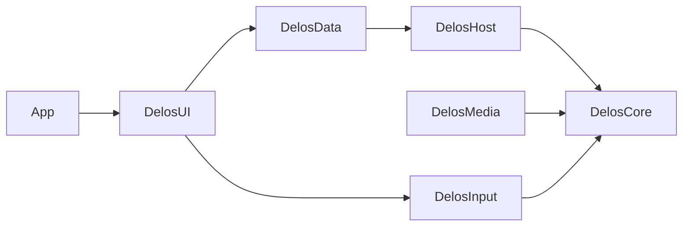

# Architecture

## Purpose

How DELOS for Apple is divided into modules, which way they may depend on each other, and where each part of the app
belongs.

## Modules

The app target (`App/`) only starts the interface. All code is in the Swift package `Packages/DelosKit`:

| Module | Contents | May import SwiftUI |
|---|---|---|
| `DelosUI` | Design tokens, fonts, icons, shaders, components, the focus engine, the screens | Yes |
| `DelosData` | Stored data: hosts, profiles, settings, playtime, artwork | No |
| `DelosHost` | Discovery, pairing, the HTTPS client of the host | No |
| `DelosCore` | The C streaming core `delos-common-c` and its Swift wrapper | No |
| `DelosMedia` | Video decoding and rendering, audio | No |
| `DelosInput` | Controllers, keyboard, touch, rumble, motion | No |

Modules that are still empty contain one file that names their phase.

Every module is compiled in the Swift 6 language mode with warnings as errors.

## The stage

Sizes in the specification of DELOS for Android are pixels of a 1920 × 1080 stage. `Stage` is the port of Android's
`StagePlanner`: it scales the stage to the window by the axis with less room (the other axis gets more stage pixels),
but one stage pixel is never smaller than 0.43 points, the size it has on the AYN Odin 2 Portal where DELOS was
designed. An iPhone in landscape (932 × 430 points) is therefore a 2167 × 1000 stage at the floor, not a smaller copy
of 1920 × 1080; an iPad is a taller stage (1920 × 1440 at 4:3). `StageShape` (wide, standard, tall, compact) names the
layout family, and `Stage.safe` holds the safe area in stage pixels: the window fills the screen, and content anchored
to an edge keeps clear of the safe area itself. Views read the stage from the environment and write sizes as
`stage.px(26)`.

## Focus

On tvOS the system focus engine moves the focus. On iPhone, iPad and Mac a game controller does not drive SwiftUI's
focus, so `MenuInput` (DelosInput) turns the D-pad, the left stick, A, B and the arrow, Return and Escape keys into
commands, and `FocusModel` (DelosUI) moves the focus to the nearest item in the pressed direction (`FocusGeometry`).
`FocusItem` wraps a view for both engines.
A `FocusItem` can name where a direction leads instead of the nearest item (`moves`): the avatar grid continues a
row's end in the next row.

## Navigation

`Navigator` (DelosUI) is the screen router: an `@Observable` back stack of `Screen` values (`boot`, `createProfile`,
`start`, `profile`), each entry with its own `FocusModel`, so going back returns the focus to where it was. `DelosRoot`
shows the top entry with the screen transition of the prototype (a fade with a slight zoom).

| Call | Use |
|---|---|
| `push(_:focus:)` | Opens a screen above the current one with the focus on an item |
| `back()` | B, Escape or the Menu button of the Siri Remote: pops the top screen; false at the root, where the system handles it |
| `reset(to:focus:)` | Replaces the stack: the first run is over, or starts again after the last profile was deleted |

While a text field is typed in, `isEditingText` is true and `DelosRoot` gives the controller and keyboard commands to
the field instead of the focus; B or Escape stops typing. The Return that ends typing also reaches `MenuInput` as a key
press, so an accept within 0.3 s after it is ignored (`swallowsAccept`).

## Sounds and haptics

`Feedback` plays the five interface sounds of DELOS for Android (move, select, back, open, error) as system sounds, so
they mix with other audio and follow the silent switch, and on iPhone and iPad a matching system haptic.
Moving the focus plays move, activating an item plays select.

## Backgrounds

The animated backgrounds are Metal stitchable shaders in `DelosUI`, ported line by line from the AGSL sources of DELOS
for Android (`shell/ui/BackgroundShaders.kt`). Contour exists so far.

## Settings

`Appearance` (DelosData) holds Settings → Appearance with the defaults of DELOS for Android. `AppearanceStore` keeps one
per profile in `UserDefaults`; reading is lenient, so an unknown option falls back to its default without losing the
other settings.

## Profiles and the first run

`ProfileStore` (DelosData) keeps the profiles of DELOS for Android (`shell/data/Profiles.kt`): an id (a lower-case
UUID), a name (trimmed, at most 20 characters, never blank) and the index of the avatar. The list and the current id are
one Codable value in `UserDefaults`; reading is lenient, so an unreadable profile is skipped and the others are kept. A
new profile starts with a copy of the current one's appearance and becomes the current one; deleting a profile removes
its appearance, and the first remaining profile takes over. Each profile's settings are stored under its id
(`AppearanceStore`), and `DelosRoot` applies the current profile's appearance.

Without a profile DELOS is on its first run: `DelosRoot` starts on the boot screen, "Get started" opens the
create-profile page, and creating the profile goes on to the start screen. The start screen greets the current profile
and shows its chip at the top; the chip opens the profile screen (Change avatar, Add profile, Delete profile).

The sixteen avatars (`Avatar.all` in DelosUI) are DELOS for Android's, in its order, because a profile stores the index.
Their 384 px WebP illustrations are decoded by ImageIO off the main thread and kept in memory; `avatars.json` gives each
its badge gradient. A missing image keeps the avatar's font icon.

Not ported yet, because the layers they need do not exist: the profiles context menu (Switch profile; the chip opens the
profile screen instead), the Rename dialog (the name is typed on the Change avatar page), the Undo toast after Delete,
the welcome toast, the pairing step after the first profile, Skip to home (it needs paired PCs) and the sideways
scrolling avatar rows of a stage 1500 to 1800 px wide.

## Strings

User-visible text comes from DELOS for Android's string resources, so both apps say the same thing in the same ten
languages. `tools/l10n/keys.txt` lists the names the Apple app uses; `tools/l10n/import_android.py <Android checkout>`
copies them with every translation into `DelosUI/Resources/Localizable.xcstrings` (placeholders converted to Apple's
format, plurals as plural variations). Swift reads them with `L("name")`; `tools/l10n/check_usage.py` (part of
`tools/test.sh`) fails when a used name is missing or lacks a language. `App/Shared/InfoPlist.xcstrings` gives the app
bundle the same ten languages; without it iOS shows the package's strings in English only.

## Verification

- `swift test` in `Packages/DelosKit`: colors against an independent HSL implementation, focus geometry and model,
  stage scaling, controller stick and key mapping, the profile store (create, rename, avatar, switch, delete, lenient
  reading, the first run), the navigator's back stack, the avatar set (every WebP decodes through ImageIO, the badge
  colors) and the plural of "Signed in on this …".
- `sh tools/sim.sh iphone|ipad|tv`: the start screen in the simulators. The boot, create-profile, start and profile
  screens were looked at in the iPhone, iPad and Apple TV simulators (in Czech).
- The start screen in Czech in the iPhone simulator (`-AppleLanguages (cs)`).
- `python3 -m unittest discover -s tools/l10n`: placeholder and escape conversion, the usage check.

### Not verified

- Moving the focus with a real game controller on iPhone and iPad (the simulator has no controller); the logic is
  covered by the unit tests only.
- Performance of the Contour shader on a device.
- How the sounds and haptics feel on a device.
- Typing a profile name: the simulators were not driven by a keyboard, a controller or the Siri Remote, so the text
  field, B while typing and the tvOS keyboard were not tried.
