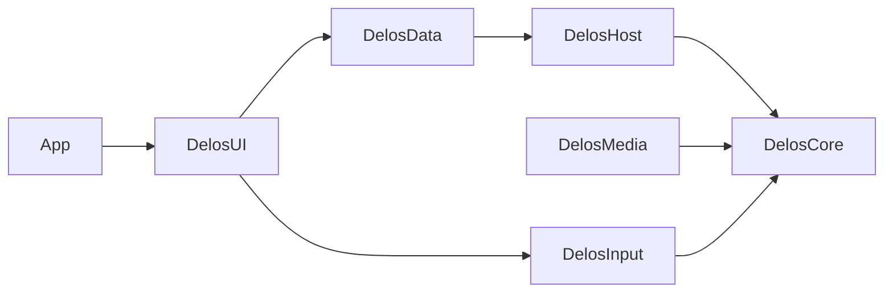

# Architecture

## Purpose

How DELOS for Apple is divided into modules, which way they may depend on each other, and where each part of the app
belongs.

## Modules

The app target (`App/`) only starts the interface. All code is in the Swift package `Packages/DelosKit`:

| Module | Contents | May import SwiftUI |
|---|---|---|
| `DelosUI` | Design tokens, fonts, icons, shaders, components, the focus engine, the screens | Yes |
| `DelosData` | Stored data: hosts, profiles, settings, playtime, artwork | No |
| `DelosHost` | Discovery, pairing, the HTTPS client of the host | No |
| `DelosCore` | The C streaming core `delos-common-c` and its Swift wrapper | No |
| `DelosMedia` | Video decoding and rendering, audio | No |
| `DelosInput` | Controllers, keyboard, touch, rumble, motion | No |

Modules that are still empty contain one file that names their phase.

Every module is compiled in the Swift 6 language mode with warnings as errors.

## The stage

Sizes in the specification of DELOS for Android are pixels of a 1920 × 1080 stage. `Stage` scales them to the screen
by the axis with less room; the other axis gets the extra space. Views read the stage from the environment and write
sizes as `stage.px(26)`.

## Focus

On tvOS the system focus engine moves the focus. On iPhone, iPad and Mac a game controller does not drive SwiftUI's
focus, so `MenuInput` (DelosInput) turns the D-pad, the left stick, A, B and the arrow, Return and Escape keys into
commands, and `FocusModel` (DelosUI) moves the focus to the nearest item in the pressed direction (`FocusGeometry`).
`FocusItem` wraps a view for both engines.

## Sounds and haptics

`Feedback` plays the five interface sounds of DELOS for Android (move, select, back, open, error) in the ambient audio
session, so they mix with other audio and follow the silent switch, and on iPhone and iPad a matching system haptic.
Moving the focus plays move, activating an item plays select.

## Backgrounds

The animated backgrounds are Metal stitchable shaders in `DelosUI`, ported line by line from the AGSL sources of DELOS
for Android (`shell/ui/BackgroundShaders.kt`). Contour exists so far.

## Strings

User-visible text comes from DELOS for Android's string resources, so both apps say the same thing in the same ten
languages. `tools/l10n/keys.txt` lists the names the Apple app uses; `tools/l10n/import_android.py <Android checkout>`
copies them with every translation into `DelosUI/Resources/Localizable.xcstrings` (placeholders converted to Apple's
format, plurals as plural variations). Swift reads them with `L("name")`; `tools/l10n/check_usage.py` (part of
`tools/test.sh`) fails when a used name is missing or lacks a language. `App/Shared/InfoPlist.xcstrings` gives the app
bundle the same ten languages; without it iOS shows the package's strings in English only.

## Verification

- `swift test` in `Packages/DelosKit`: colors against an independent HSL implementation, focus geometry and model,
  stage scaling, controller stick and key mapping.
- `sh tools/sim.sh iphone|ipad|tv`: the start screen in the simulators.
- The start screen in Czech in the iPhone simulator (`-AppleLanguages (cs)`).
- `python3 -m unittest discover -s tools/l10n`: placeholder and escape conversion, the usage check.

### Not verified

- Moving the focus with a real game controller on iPhone and iPad (the simulator has no controller); the logic is
  covered by the unit tests only.
- Performance of the Contour shader on a device.
- How the sounds and haptics feel on a device.
