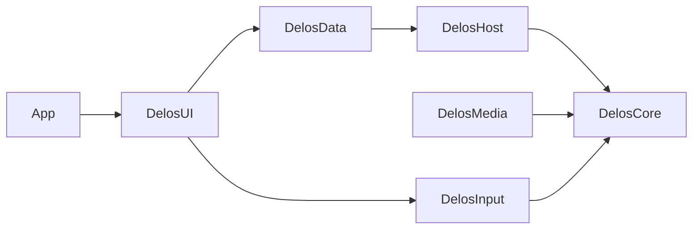

# Architecture

## Purpose

How DELOS for Apple is divided into modules, which way they may depend on each other, and where each part of the app
belongs.

## Modules

The app target (`App/`) only starts the interface. All code is in the Swift package `Packages/DelosKit`:

| Module | Contents | May import SwiftUI |
|---|---|---|
| `DelosUI` | Design tokens, fonts, icons, shaders, components, the focus engine, the screens | Yes |
| `DelosData` | Stored data: hosts, profiles, settings, playtime, artwork | No |
| `DelosHost` | Discovery, pairing, the HTTPS client of the host | No |
| `DelosCore` | The C streaming core `delos-common-c` and its Swift wrapper | No |
| `DelosMedia` | Video decoding and rendering, audio | No |
| `DelosInput` | Controllers, keyboard, touch, rumble, motion | No |

Modules that are still empty contain one file that names their phase.

Every module is compiled in the Swift 6 language mode with warnings as errors.

## The stage

Sizes in the specification of DELOS for Android are pixels of a 1920 × 1080 stage. `Stage` is the port of Android's
`StagePlanner`: it scales the stage to the window by the axis with less room (the other axis gets more stage pixels),
but one stage pixel is never smaller than 0.43 points, the size it has on the AYN Odin 2 Portal where DELOS was
designed. An iPhone in landscape (932 × 430 points) is therefore a 2167 × 1000 stage at the floor, not a smaller copy
of 1920 × 1080; an iPad is a taller stage (1920 × 1440 at 4:3). `StageShape` (wide, standard, tall, compact) names the
layout family, and `Stage.safe` holds the safe area in stage pixels: the window fills the screen, and content anchored
to an edge keeps clear of the safe area itself. Views read the stage from the environment and write sizes as
`stage.px(26)`.

## Focus

On tvOS the system focus engine moves the focus. On iPhone, iPad and Mac a game controller does not drive SwiftUI's
focus, so `MenuInput` (DelosInput) turns the D-pad, the left stick, A, B and the arrow, Return and Escape keys into
commands, and `FocusModel` (DelosUI) moves the focus to the nearest item in the pressed direction (`FocusGeometry`).
`FocusItem` wraps a view for both engines.

## Sounds and haptics

`Feedback` plays the five interface sounds of DELOS for Android (move, select, back, open, error) as system sounds, so
they mix with other audio and follow the silent switch, and on iPhone and iPad a matching system haptic.
Moving the focus plays move, activating an item plays select.

## Backgrounds

`Backdrop(kind:)` draws every background of DELOS for Android (`BackgroundKind`), ported from `AnimatedBackground` in
`shell/ui/Backdrop.kt` and the AGSL sources in `shell/ui/BackgroundShaders.kt`. As there, the theme color lies at the
bottom; over it a layer with the base gradient (`hsl(base, 40, 8)` → `hsl(base, 38, 5)` dark, `hsl(base, 45, 96)` →
`hsl(base, 38, 90)` light) and the background, blended with "screen" in the dark theme. Everything is drawn on the
prototype's 960 × 540 canvas, scaled uniformly and extended along the longer axis (`BackgroundParams.canvas(for:)`).
The clock runs at 0.96 per second, 0.15 of that with reduced motion. `BackgroundParams` is Android's `BgParams`
(hues, saturations, `s()`) with `lights()`, the three colors of the shader backgrounds.

| Kind | Android | Apple |
|---|---|---|
| Aurora, Tide, Silk | `drawAurora`, `drawTide`, `drawSilk` on the Compose canvas | `CanvasBackgrounds` on a SwiftUI `Canvas`, same shapes, colors and alphas; plus-lighter (Android: Plus) in the dark theme |
| Contour | AGSL `CONTOUR` and the radial glow in `drawContour` | `Contour.metal` and a `RadialGradient` |
| Nebula, Plasma, Lava, Caustics, Bokeh, Orbit | AGSL with the shared `PRELUDE` (`hash`, `noise`, `fbm`, `tri`, `pick`, `emit`) | `Backgrounds.metal`, `[[stitchable]]` color effects; glow 0.62 dark / 0.5 light, plus-lighter dark / normal light |
| Still | the base gradient | the base gradient |

The Metal ports differ from the AGSL text only where Metal must: GLSL's `mod()` is written out (`x - y * floor(x / y)`,
Metal's `fmod` keeps the sign of `x`), `atan` is `atan2`, the hash uses `precise::sin` (large arguments), and Orbit's
`pow(d, 2.0)` of a negative `d` is `d * d`. The fallback of Android below version 13 (Aurora in place of a shader) is
not needed. The focused game's colors (`clock.tints`) and the game background are not ported yet; Material You has no
counterpart. In debug builds `-DelosBackground <kind>` and `-DelosTheme light` pick the background and the theme
([BUILDING.md](BUILDING.md)).

## Settings

`Appearance` (DelosData) holds Settings → Appearance with the defaults of DELOS for Android. `AppearanceStore` keeps one
per profile in `UserDefaults`; reading is lenient, so an unknown option falls back to its default without losing the
other settings.

## Strings

User-visible text comes from DELOS for Android's string resources, so both apps say the same thing in the same ten
languages. `tools/l10n/keys.txt` lists the names the Apple app uses; `tools/l10n/import_android.py <Android checkout>`
copies them with every translation into `DelosUI/Resources/Localizable.xcstrings` (placeholders converted to Apple's
format, plurals as plural variations). Swift reads them with `L("name")`; `tools/l10n/check_usage.py` (part of
`tools/test.sh`) fails when a used name is missing or lacks a language. `App/Shared/InfoPlist.xcstrings` gives the app
bundle the same ten languages; without it iOS shows the package's strings in English only.

## Verification

- `swift test` in `Packages/DelosKit`: colors against an independent HSL implementation, focus geometry and model,
  stage scaling, controller stick and key mapping, the background lights and saturations against the Kotlin formulas,
  and that every background shader is in the Metal library.
- `sh tools/sim.sh iphone|ipad|tv`: the start screen in the simulators.
- The start screen in Czech in the iPhone simulator (`-AppleLanguages (cs)`).
- Every background in the iPhone simulator (dark theme; Contour and Nebula also light), compared with the Android code.
- `python3 -m unittest discover -s tools/l10n`: placeholder and escape conversion, the usage check.

### Not verified

- Moving the focus with a real game controller on iPhone and iPad (the simulator has no controller); the logic is
  covered by the unit tests only.
- GPU cost of the backgrounds (the shaders and the canvas ones) on a device.
- How the sounds and haptics feel on a device.
