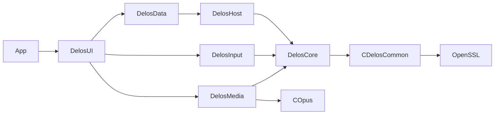

# Architecture

## Purpose

How DELOS for Apple is divided into modules, which way they may depend on each other, and where each part of the app
belongs.

## Modules

The app target (`App/`) only starts the interface. All code is in the Swift package `Packages/DelosKit`:

| Module | Contents | May import SwiftUI |
|---|---|---|
| `DelosUI` | Design tokens, fonts, icons, shaders, components, the focus engine, the screens | Yes |
| `DelosData` | Stored data: hosts, profiles, settings, playtime, artwork | No |
| `DelosHost` | Discovery, pairing, the HTTP(S) client of the host, the client identity, Wake-on-LAN | No |
| `DelosCore` | The C streaming core `delos-common-c` (C target `CDelosCommon`) and its Swift wrapper | No |
| `DelosMedia` | Video decoding and rendering, audio; Opus decoding (C target `COpus`) | No |
| `DelosInput` | Controllers, keyboard, touch, rumble, motion | No |

Modules that are still empty contain one file that names their phase.

Every module is compiled in the Swift 6 language mode with warnings as errors.

## The stage

Sizes in the specification of DELOS for Android are pixels of a 1920 × 1080 stage. `Stage` is the port of Android's
`StagePlanner`: it scales the stage to the window by the axis with less room (the other axis gets more stage pixels),
but one stage pixel is never smaller than 0.43 points, the size it has on the AYN Odin 2 Portal where DELOS was
designed. An iPhone in landscape (932 × 430 points) is therefore a 2167 × 1000 stage at the floor, not a smaller copy
of 1920 × 1080; an iPad is a taller stage (1920 × 1440 at 4:3). `StageShape` (wide, standard, tall, compact) names the
layout family, and `Stage.safe` holds the safe area in stage pixels: the window fills the screen, and content anchored
to an edge keeps clear of the safe area itself. Views read the stage from the environment and write sizes as
`stage.px(26)`.

## Focus

On iPhone and iPad every screen that can go back shows a back button at the top left: a touch user has no B button,
and iOS has no system back (Android's system back covers this there).

On tvOS the system focus engine moves the focus. On iPhone, iPad and Mac a game controller does not drive SwiftUI's
focus, so `MenuInput` (DelosInput) turns the D-pad, the left stick, A, B and the arrow, Return and Escape keys into
commands, and `FocusModel` (DelosUI) moves the focus to the nearest item in the pressed direction (`FocusGeometry`).
`FocusItem` wraps a view for both engines.
A `FocusItem` can name where a direction leads instead of the nearest item (`moves`): the avatar grid continues a
row's end in the next row.

## Navigation

`Navigator` (DelosUI) is the screen router: an `@Observable` back stack of `Screen` values (`boot`, `createProfile`,
`start`, `profile`, `pair`, `pairAddress`, `pin`, `home`, `stream`), each entry with its own `FocusModel`, so going back
returns the focus to where it was. `DelosRoot` shows the top entry with the screen transition of the prototype (a fade
with a slight zoom), and puts the navigator and the one `HostStore` in the environment.

| Call | Use |
|---|---|
| `push(_:focus:)` | Opens a screen above the current one with the focus on an item |
| `back()` | B, Escape or the Menu button of the Siri Remote: pops the top screen; false at the root, where the system handles it |
| `reset(to:focus:)` | Replaces the stack: the first run is over, or starts again after the last profile was deleted |
| `openHome(hostID:)` | A PC's library above the start screen (from the start screen, or once pairing is done: B returns to the start screen) |
| `openStream(hostID:appID:)` | Pushes the stream of an app |

While a text field is typed in, `isEditingText` is true and `DelosRoot` gives the controller and keyboard commands to
the field instead of the focus; B or Escape stops typing. The Return that ends typing also reaches `MenuInput` as a key
press, so an accept within 0.3 s after it is ignored (`swallowsAccept`). While `commandCapture` is set (the stream
screen), every command goes there first.

Short messages (a pairing that failed, an address that does not answer) are toasts (`Toasts`): one at a time at the
bottom of the stage, gone after 3.5 s.

## Video formats

`DelosMedia` turns what the host sends into what VideoToolbox decodes, without FFmpeg:

| Codec | Stream from the host | Format description | Sample data |
|---|---|---|---|
| H.264 | Annex B NAL units | from SPS and PPS | length-prefixed NAL units without parameter sets |
| HEVC | Annex B NAL units | from VPS, SPS and PPS | the same |
| AV1 | low-overhead OBUs | from the sequence header: `av1C` record, bit depth, range and color (BT.709, BT.2020 with PQ or HLG) | the OBUs unchanged |

`AV1.parseSequenceHeader` reads the sequence header (AV1 specification, section 5.5) with `BitReader`.

`VideoSamples` keeps the format description of the running stream (replaced when a key frame brings different
parameter sets) and wraps each frame in a sample buffer marked "display immediately", since the host paces the stream;
a frame before the first key frame fails with `needsKeyFrame`, the signal to ask the host for one. `VideoRenderer` is the
renderer interface; `DisplayLayerRenderer` shows the samples through `AVSampleBufferDisplayLayer` (decision L4).

## Stream output

`VideoOutput` and `AudioOutput` (DelosMedia) are the sinks the stream session hands the core. `VideoOutput` joins each
decode unit's buffers into one Annex B or OBU frame, wraps it with `VideoSamples` and gives it to the renderer; a frame
that cannot be shown answers `needIDRFrame`, so the core asks the host for a key frame. `AudioOutput` decodes the Opus
packets on the core's audio thread into an `AudioRing` and plays them through an `AVAudioEngine` source node in the
playback audio session; the ring keeps at most 60 ms and drops the oldest samples beyond that, so a network burst does
not add lasting delay. The core calls each sink from one thread at a time, which is why their state has no lock; only the
ring, read by the render thread, has one.

## The stream screen

`StreamScreen` (DelosUI) shows one stream: `Screen.stream(hostID:appID:)`. `StreamController` runs it in phases:
connecting (the loader), streaming, leaving, failed (the result overlay) and ended (the screen goes back). The steps
that talk to the PC and the core are behind the `StreamSteps` protocol, so the tests drive the controller with a fake;
`LiveStream` is the real one.

| Step | What happens |
|---|---|
| Display | `VideoSurface` (a thin `UIView` host of the `AVSampleBufferDisplayLayer`, full screen, aspect fit, black) reports the screen's pixel size and highest refresh rate once it is in a window; the stream starts then |
| Launch | `HostStore.refresh` asks the PC again over its pinned connection: offline and "not paired" end here. The app is found in the loaded app list (else it is loaded). `StreamSettings.forDisplay` and `StreamPlan` with the formats VideoToolbox decodes in hardware (`DecoderSupport`: H.264 always, HEVC and AV1 8-bit where supported; 10-bit waits for HDR). The app is resumed when the PC runs it, another running app is quit first, else it is launched (`NvConnection.startApp` of DELOS for Android) |
| Connect | `StreamSession.start` with `VideoOutput(DisplayLayerRenderer)` and `AudioOutput`, the server information of the launch's session URL. Each `stageStarting` event tells a line of the stage (Android's `stream_loader_lines_*`) and adds 8 % to the progress, up to 92 % |
| Stream | `connectionStarted`: the video shows, `GameInput` starts; rumble events go to the controllers. A termination shows the result overlay (`StreamText.termination`, Android's `describeStreamFailure`); a graceful end goes back (without Android's toast "The PC ended the stream" yet) |
| Leave | Disconnect stops the session (the app keeps running on the PC); Quit app also asks the PC to quit it (`cancel`), and a refusal shows "The PC did not quit …". Leaving the screen any other way disconnects |

The result overlay is Android's `StreamResultLayer`: a sad face, the title, one sentence, Try again (focused first) and
Back to library, and the technical text behind Details. B is Back to library. A launch the PC refused shows Android's
`conn_*` message (resume foreign 470, app minimized 525, quit foreign 599, denied 403).

During the stream the screen stays on (`isIdleTimerDisabled`), the system overlays are hidden and the system gestures
deferred. `Navigator.commandCapture` gives the stream screen every controller and keyboard command first: while the
stream runs nothing reaches the screens behind it, the stream menu and the result overlay use the screen's focus, B
closes the menu, and B while connecting leaves. The statistics overlay is not ported yet.

### The stream menu

It opens as in DELOS for Android by default: L3 + R3 held together (`MenuShortcut`, Android's `ButtonShortcut`: the
button that completes the shortcut is kept from the PC, the menu opens when both are let go), or a swipe up from the
bottom edge of the touch screen (`MenuSwipe`: a touch starting in the bottom 6 % belongs to the swipe and does not reach
the PC; 12 % of the height up opens the menu). The menu is minimal: Resume, Disconnect and Quit app from Android's dock.
While it is open, `GameInput` sends nothing and releases every held button, key and mouse button at the PC.

### Input during a stream

`GameInput` (DelosInput) sends to a `StreamInputSink` (the running `StreamSession`).

| Device | Mapping |
|---|---|
| Game controller (`GCExtendedGamepad`) | Lowest free controller number (`ControllerSlots`, up to 16, the active mask); an arrival event with the type (Xbox, PlayStation, Switch by product category), the buttons it has and its capabilities (analog triggers, rumble and trigger rumble from the haptic localities, LED, battery, motion). The gamepad's profile-level change handler sends the full state: `GamepadMapping` (Menu = Start, Options = Back, Home = Guide, paddles, touchpad button, Share; sticks −1…1 → ±32767, y up; triggers 0…1 → 0…255). The buttons' system gestures are off while the stream runs |
| Rumble | `ControllerHaptics`: a CoreHaptics engine of the controller per motor (low frequency → left handle, high → right handle, trigger motors → triggers) playing an endless continuous event whose intensity follows the PC's amplitude, as Moonlight for iOS does |
| Hardware keyboard (`GCKeyboard`) | Per-key handlers; HID usage → Windows virtual-key code (`KeyboardMapping`, Moonlight's table) with the `0x8000` prefix; the modifiers from the held Shift, Control, Alt (Option) and Command keys |
| Mouse (`GCMouse`) | Relative motion (divided by 1.25, as Moonlight), left, right, middle and two side buttons, scroll in 1/120 notches (20 per unit) |
| Touch | Android's default trackpad mode (`TouchTrackpad`): one finger moves the pointer by its motion in screen pixels, a tap shorter than 230 ms and 30 pixels clicks left, a two-finger tap clicks right, two fingers moving scroll (3 wheel units per pixel). Pointer touches are ignored while a mouse is connected |

The gamepad and keyboard handlers sit next to `MenuInput`'s (which sets the per-element and the keyboard-wide
handlers), so both work; `commandCapture` decides who uses the commands.

### Frame rate

`CADisableMinimumFrameDurationOnPhone` is in `Config/Info.plist` (no `INFOPLIST_KEY_*` setting exists for it), so a
ProMotion iPhone reports and can show 120 Hz; the stream asks the host for 60 fps (the default of DELOS for Android) with
the display's refresh rate as the client refresh rate.

## Sounds and haptics

`Feedback` plays the five interface sounds of DELOS for Android (move, select, back, open, error) as system sounds, so
they mix with other audio and follow the silent switch, and on iPhone and iPad a matching system haptic.
Moving the focus plays move, activating an item plays select.

## Glass

Where DELOS for Android blurs the background behind a surface (`Modifier.glass`), the Apple app uses Liquid Glass
(`GlassShape`, iOS, iPadOS and tvOS 26 and later); before 26 the surface token is a plain fill. Every glass surface has
one role, so the same kind of element looks the same everywhere:

| Role | Elements | Glass |
|---|---|---|
| `control` | Circles, chips, secondary pills, the back button, text fields: what can be pressed or focused | Regular, tinted with the surface token at 45 % of its alpha, interactive on iPhone and iPad (it reacts to touch) |
| `panel` | Cards, panels, toasts, the PIN digits: what is read | Regular, tinted at 60 %, not interactive, for text contrast |
| over the video (`glassOverMedia`) | The stream menu and anything shown over the stream | Clear (the picture shows through), tinted with the scrim token for contrast |

Not glass: primary buttons (solid main color, as on Android), focus rings, progress bars and cover art.

## Backgrounds

`Backdrop(kind:)` draws every background of DELOS for Android (`BackgroundKind`), ported from `AnimatedBackground` in
`shell/ui/Backdrop.kt` and the AGSL sources in `shell/ui/BackgroundShaders.kt`. As there, the theme color lies at the
bottom; over it a layer with the base gradient (`hsl(base, 40, 8)` → `hsl(base, 38, 5)` dark, `hsl(base, 45, 96)` →
`hsl(base, 38, 90)` light) and the background, blended with "screen" in the dark theme. Everything is drawn on the
prototype's 960 × 540 canvas, scaled uniformly and extended along the longer axis (`BackgroundParams.canvas(for:)`).
The clock runs at 0.96 per second, 0.15 of that with reduced motion. `BackgroundParams` is Android's `BgParams`
(hues, saturations, `s()`) with `lights()`, the three colors of the shader backgrounds.

| Kind | Android | Apple |
|---|---|---|
| Aurora, Tide, Silk | `drawAurora`, `drawTide`, `drawSilk` on the Compose canvas | `CanvasBackgrounds` on a SwiftUI `Canvas`, same shapes, colors and alphas; plus-lighter (Android: Plus) in the dark theme |
| Contour | AGSL `CONTOUR` and the radial glow in `drawContour` | `Contour.metal` and a `RadialGradient` |
| Nebula, Plasma, Lava, Caustics, Bokeh, Orbit | AGSL with the shared `PRELUDE` (`hash`, `noise`, `fbm`, `tri`, `pick`, `emit`) | `Backgrounds.metal`, `[[stitchable]]` color effects; glow 0.62 dark / 0.5 light, plus-lighter dark / normal light |
| Still | the base gradient | the base gradient |

The Metal ports differ from the AGSL text only where Metal must: GLSL's `mod()` is written out (`x - y * floor(x / y)`,
Metal's `fmod` keeps the sign of `x`), `atan` is `atan2`, the hash uses `precise::sin` (large arguments), and Orbit's
`pow(d, 2.0)` of a negative `d` is `d * d`. Tide always samples its waves at the right edge too: Android stops at the
last multiple of 12 pixels, which is the edge only at 16:9, and on a wider screen the waves would slope down to the
corner. The fallback of Android below version 13 (Aurora in place of a shader) is not needed. The focused game's colors
(`clock.tints`) and the game background are not ported yet; Material You has no
counterpart. In debug builds `-DelosBackground <kind>` and `-DelosTheme light` pick the background and the theme
([BUILDING.md](BUILDING.md)).

## Settings

`Appearance` (DelosData) holds Settings → Appearance with the defaults of DELOS for Android. `AppearanceStore` keeps one
per profile in `UserDefaults`; reading is lenient, so an unknown option falls back to its default without losing the
other settings.

## Profiles and the first run

`ProfileStore` (DelosData) keeps the profiles of DELOS for Android (`shell/data/Profiles.kt`): an id (a lower-case
UUID), a name (trimmed, at most 20 characters, never blank) and the index of the avatar. The list and the current id are
one Codable value in `UserDefaults`; reading is lenient, so an unreadable profile is skipped and the others are kept. A
new profile starts with a copy of the current one's appearance and becomes the current one; deleting a profile removes
its appearance, and the first remaining profile takes over. Each profile's settings are stored under its id
(`AppearanceStore`), and `DelosRoot` applies the current profile's appearance.

Without a profile DELOS is on its first run: `DelosRoot` starts on the boot screen, "Get started" opens the
create-profile page, and creating the profile goes on to pairing, above the start screen. The start screen greets the
current profile and shows its chip at the top; the chip opens the profile screen (Change avatar, Add profile, Delete
profile).

The sixteen avatars (`Avatar.all` in DelosUI) are DELOS for Android's, in its order, because a profile stores the index.
Their 384 px WebP illustrations are decoded by ImageIO off the main thread and kept in memory; `avatars.json` gives each
its badge gradient. A missing image keeps the avatar's font icon.

Not ported yet, because the layers they need do not exist: the profiles context menu (Switch profile; the chip opens the
profile screen instead), the Rename dialog (the name is typed on the Change avatar page), the Undo toast after Delete,
the welcome toast, Skip to home (it needs paired PCs) and the sideways
scrolling avatar rows of a stage 1500 to 1800 px wide.

## PCs and stream plans

`HostStore` (DelosData) is the app's list of PCs: discovery and typed addresses add them (`ask`), `refresh` asks a
known PC again (over HTTPS to its pinned certificate once paired; no answer marks it offline), `pair` runs the PIN
pairing with a four-digit PIN the app shows, and `loadApps` reads a paired PC's apps. Only paired PCs are stored
(`UserDefaults`, JSON; a record that no longer decodes is skipped, the others are kept); they start offline until
refreshed. `StreamPlan` makes the launch request and the stream configuration of one stream with one random remote
input key (the IV is the key id, big-endian), the default bitrate of DELOS for Android (`getDefaultBitrate`) and
stereo audio; `StreamSettings.forDisplay` takes the display's resolution, capped at 1080p.

The screens (DelosUI, as DELOS for Android's `DeviceScreens.kt`, `PairScreens.kt` and `HomeScreen.kt`):

- The start screen shows every paired PC (online, asleep when its MAC address is known, offline) and "Pair a new PC";
  showing it starts discovery and asks the paired PCs again. A opens the PC's library.
- Pairing lists every known PC (found ones first, online before offline, then paired ones), "Enter address" (a system
  text field; `HostAddress.parse`, default port 47989) and "Search again" (discovery restarts). Choosing an unpaired PC
  opens the PIN screen, which runs `HostStore.pair` while it shows; leaving it cancels the task, and `HostClient.pair`
  then asks the PC to unpair (from a task of its own), as after any failure. Pairing results map to Android's messages
  (`PairFailure`); a paired PC opens its library.
- The library (first version) loads the apps when it shows and lays them out as Android's row of covers (300 × 450,
  the first three covers wide, the focused one at the row's start) with the PC's box art; A opens the stream.

Not ported yet: the default PC, the PCs' context menus (wake, rename, pair with a one-time code), waking an asleep PC on
A, the companion screen; in the library the hero background, SteamGridDB artwork, game info chips, the game menu,
hidden games, last played, per-game settings and the running-app choices.

## Strings

User-visible text comes from DELOS for Android's string resources, so both apps say the same thing in the same ten
languages. `tools/l10n/keys.txt` lists the names the Apple app uses; `tools/l10n/import_android.py <Android checkout>`
copies them with every translation into `DelosUI/Resources/Localizable.xcstrings` (placeholders converted to Apple's
format, plurals as plural variations, item i of a string array as `<array>_<i>`). Swift reads them with `L("name")`;
`tools/l10n/check_usage.py` (part of `tools/test.sh`) fails when a used name is missing or lacks a language.
`App/Shared/InfoPlist.xcstrings` gives the app bundle the same ten languages; without it iOS shows the package's strings
in English only.

## The streaming core

### C sources

The C code comes from two submodules: `ThirdParty/delos-common-c` (the DELOS core, shared with DELOS for Android,
with its own submodules `enet` and `nanors`) and `ThirdParty/opus` (libopus at a release tag). SwiftPM builds only
files inside the package directory, so each C target directory holds a relative symlink to its submodule:

| Target | Symlink | Built files | Settings |
|---|---|---|---|
| `CDelosCommon` | `Sources/CDelosCommon/core` → `ThirdParty/delos-common-c` | `src/*.c`, the Unix files of `enet`, `nanors/rs.c` and `oblas_*`, as in the core's `CMakeLists.txt`; plus `DelosLog.c` | `HAS_SOCKLEN_T`, `__APPLE_USE_RFC_3542`; `LC_DEBUG` in debug, `NDEBUG` in release, as in Moonlight's `moonlight-common.xcodeproj`; OpenSSL from `OpenSSL-Package` |
| `COpus` | `Sources/COpus/opus` → `ThirdParty/opus` | the lists of `opus_sources.mk`, `celt_sources.mk` and `silk_sources.mk` for a floating-point build | `config/config.h` replaces the generated configuration; NEON intrinsics are presumed on arm64 (`neon/` compiles the NEON files on arm64 only, because SwiftPM cannot select files by architecture) |

`include/` of each target has the umbrella header of its Clang module. The only C written for DELOS is `DelosLog.c`:
the core logs through a variadic callback, which Swift cannot define, so it formats the message and hands a plain
string to Swift. Apple's toolchain warns about 64-to-32-bit conversions in the third-party code; the targets switch
that warning off instead of changing the submodules.

### Swift wrapper

`StreamConfiguration` and `ServerInformation` map to the core's `STREAM_CONFIGURATION` and `SERVER_INFORMATION`; the
bit sets `VideoFormats`, `ServerCodecModes` and `EncryptionFlags` carry the core's constants, and the PyroWave fields
are carried for parity with Android but unused. `StreamSession` (an actor) runs one connection: `start` runs the
blocking `LiStartConnection` on its own thread and throws `StreamError` with the failing stage, `stop` runs
`LiStopConnection`, and `events` is an `AsyncStream` of stage progress, connection status, termination, rumble, LEDs,
motion and trigger requests. Video decode units and audio packets go to `Sendable` sinks (`VideoDecodeUnitSink`,
`AudioSampleSink`); a `DecodeUnit` is non-copyable and borrowed, so the core's memory cannot outlive the call. Input
(`sendController`, mouse, keyboard, text, scroll, touch) and statistics are `nonisolated` and call the core directly.

The core keeps its connection in global state and its callbacks get no context pointer. So one global `CoreContext`
(`CoreBridge`, behind a `Mutex`) connects the callbacks to the session that holds the core; a second session cannot
start while one is active. The callbacks run on the core's threads.

`OpusMultistreamDecoder` (DelosMedia) decodes the host's multistream packets to interleaved float samples and conceals
lost packets.

## The host layer (DelosHost)

`DelosHost` speaks the GameStream HTTP protocol of Sunshine, Apollo, Vibepollo and GeForce Experience. It holds no
state: `DelosData` stores `HostRecord` values, and the screens call `HostClient`.

| Part | Type | What it does |
|---|---|---|
| Discovery | `HostDiscovery` | `NWBrowser` for `_nvstream._tcp`; each service is resolved by a short TCP connection to it; events as an `AsyncStream` |
| Typed address | `HostAddress.parse` | IPv4, IPv6 with or without brackets, host names, optional port; the contract table of DELOS for Android (`PcSetupTest`) |
| Requests | `HostClient` | `serverinfo`, `applist`, `appasset`, `launch`, `resume`, `cancel`, `unpair`, pairing; XML read with `XMLParser` |
| Transport | `HTTPTransport` | One HTTP/1.1 GET per Network.framework connection; HTTPS with the pin and the client certificate |
| Pairing | `HostClient.pair` | The PIN handshake of `PairingManager`: AES-128-ECB (CommonCrypto), SHA-256 from server generation 7 and SHA-1 before (CryptoKit), RSA signatures (`SecKey`) |
| Identity | `ClientIdentity`, `ClientIdentityStore` | RSA 2048 key and a self-signed X.509 certificate made on the device, kept in the Keychain |
| Stored host | `HostRecord` | What is known about a host, and the rule for updating it from an answer |
| Wake-on-LAN | `WakeOnLan` | The magic packet to every known address and the broadcast address |

Network.framework instead of URLSession: the pin is a TLS verify block that replaces the system's evaluation
completely, the client certificate is a TLS option, and plain HTTP to a PC by address or name needs no App Transport
Security exception.

### Security rules

These are the findings S-02, S-06 and S-07 of the security review of DELOS for Android, built in from the start.

- **Exclusive pin (S-07).** Pairing pins the certificate the host sent. HTTPS to that host accepts this certificate,
  byte for byte, and nothing else: no system trust store, no host name check. HTTPS is used only with a pin.
- **Unverified answers (S-06).** For a paired host, `serverinfo` goes over HTTPS. If the host shows another
  certificate or no longer knows the client (401), the answer is fetched over plain HTTP and marked `plainHTTP`.
  `HostRecord.updated(with:)` then changes only reachability (online, the address that answered,
  `lastReplyVerified = false`); name, addresses, MAC, ports and the pin stay. Before pairing nothing can be verified,
  so plain answers fill the record; the pin is only ever set by `paired(with:)`. An answer with another `uniqueid`
  is rejected.
- **Host ids (S-02).** A `uniqueid` must be 1 to 64 ASCII letters, digits or hyphens; otherwise the answer is rejected.

### Client identity

`ClientIdentity.generate()` makes an RSA 2048 key (`SecKeyCreateRandomKey`) and a self-signed X.509 v3 certificate
(common name `NVIDIA GameStream Client`, SHA-256 with RSA, valid 20 years, no extensions, as Moonlight makes it). The
certificate is encoded by a small DER writer in the module; no third-party code is used. TLS needs a `SecIdentity`,
which the Security framework only gives for keys in a keychain or from PKCS #12, so the key and certificate are packed
into a PKCS #12 container in memory (PBES2 with AES-256-CBC, HMAC-SHA256 MAC, random throwaway password) and imported
with `kSecImportToMemoryOnly`.

`ClientIdentityStore` keeps the key (PKCS #1), the certificate and the 16-digit client id as one property-list item:
a generic password of the data protection keychain, service `io.github.meitoncz.delos.client-identity`, accessible
after first unlock, this device only (not in backups, not synchronized). An item that cannot be decoded is replaced
by a new identity; a keychain that cannot be read is an error, never "no identity".

### Launch

`launch` and `resume` build the query of `NvHTTP.launchApp` of DELOS for Android, including the quirks for GeForce
Experience. The value of `LiGetLaunchUrlQueryParameters()` from the streaming core is passed in by the caller.

### Info.plist

`NSLocalNetworkUsageDescription` comes from `INFOPLIST_KEY_NSLocalNetworkUsageDescription` in `Config/Shared.xcconfig`.
`NSBonjourServices` is an array, which `INFOPLIST_KEY_*` settings cannot express, and `CADisableMinimumFrameDurationOnPhone`
has no such setting; both are in `Config/Info.plist`, which Xcode merges with the generated keys (`INFOPLIST_FILE` next to
`GENERATE_INFOPLIST_FILE = YES`).

## Verification

- `swift test` in `Packages/DelosKit`: colors against an independent HSL implementation, focus geometry and model,
  stage scaling, controller stick and key mapping, the profile store (create, rename, avatar, switch, delete, lenient
  reading, the first run), the navigator's back stack, the avatar set (every WebP decodes through ImageIO, the badge
  colors), the plural of "Signed in on this …", the background lights and saturations against the Kotlin formulas,
  and that every background shader is in the Metal library; the stream configuration and server information against the C
  structures, the audio, video format and codec bits against the protocol values, the C callbacks against events and
  sinks, input without a stream, a start against a closed local port (fails in the RTSP handshake with
  `ECONNREFUSED` after the core's 10-second retry), `stop()` and task cancellation during that retry (the start ends
  within a second), an invalid configuration, Opus encode → decode of stereo sweeps (2.5 ms delay, both channels
  above 15 dB SNR), packet loss concealment, 5.1 layout, invalid layouts and packets.
- `xcodebuild -scheme DelosCore` and `-scheme DelosMedia` for `generic/platform=iOS`, `tvOS`, `macOS` and the iOS and
  tvOS simulators.
- `swift test`, host layer (`Tests/DelosHostTests`), against a fake host on the loopback interface (Network.framework
  listeners, HTTPS with a generated identity that requires a client certificate): `serverinfo` and `applist` parsing
  with the documents of DELOS for Android's tests (Sunshine, Apollo, GeForce Experience in UTF-16), the full pairing
  against an independent implementation of the host side (correct PIN, wrong PIN, forged signature, another client
  pairing, refusals at every step, SHA-1 hosts, Apollo passphrase), pin accepted and rejected, the HTTP fallback,
  invalid host ids, the `HostRecord` update rule, the typed-address table, the Wake-on-LAN packet and its delivery to
  a loopback UDP port, Bonjour discovery of a service published on the Mac (private service type), time-outs and
  cancellation. The same tests pass in the iOS simulator (`xcodebuild test -scheme DelosKit-Package`).
- The generated certificate and PKCS #12 container were checked once with OpenSSL (`x509 -text`, `verify`,
  `pkcs12 -info`, `rsa -check`).
- The built app's `Info.plist` contains `NSLocalNetworkUsageDescription` and `NSBonjourServices` (`plutil -p`).
- A throwaway build of the app in an iOS 27.2 simulator (2026-11-16): `KeychainStorage` stored, reloaded and deleted
  the identity (package tests cannot reach the keychain: they lack the entitlement, error -34018); `HostDiscovery`
  found a real Sunshine PC on the network, and its `serverinfo` was read over plain HTTP. Nothing was paired or
  launched.
- `sh tools/sim.sh iphone|ipad|tv`: the start screen in the simulators. The boot, create-profile, start and profile
  screens were looked at in the iPhone, iPad and Apple TV simulators (in Czech).
- DelosMediaTests decode the first frame of an H.264, an HEVC and an 8-bit and a 10-bit AV1 stream with VideoToolbox on
  the Mac (AV1 is skipped where the Mac has no hardware AV1 decoder; the M6 used on 2026-11-16 has one).
- The start screen in Czech in the iPhone simulator (`-AppleLanguages (cs)`).
- Every background in the iPhone simulator (dark theme; Contour, Nebula and Aurora also light), compared with the
  Android code; Nebula, Lava and Orbit also against a NumPy reimplementation of their AGSL at the same clock.
- `python3 -m unittest discover -s tools/l10n`: placeholder and escape conversion, string arrays, the usage check.
- The stream screen without a PC (`swift test`): `StreamController` with a fake `StreamSteps` (stage lines and progress,
  the running stream, a launch failure, a failed stage, Try again, a lost connection and a graceful end, Disconnect,
  Quit app and a refused quit, leaving while connecting, who gets the controller commands), the failure texts against
  Android's rules, the PC's launch answers (470, 525, 599), the controller button flags, stick and trigger scaling,
  controller numbers, the menu shortcut, the keyboard table, the trackpad and the bottom-edge swipe, the decoder formats.
- A throwaway debug harness in the iPhone 18 Pro Max simulator (iOS 27.2, 2026-11-16), removed afterwards: the loader
  with a fake stage, the result overlay of a timed-out RTSP handshake, the stream menu, and the two H.264 test-pattern
  frames of `frames.h264` through `VideoSamples` into `DisplayLayerRenderer` and `VideoSurface` (the pattern shows,
  aspect fit on black). The built app's `Info.plist` contains `CADisableMinimumFrameDurationOnPhone` (`plutil -p`).

### Not verified

- Moving the focus with a real game controller on iPhone and iPad (the simulator has no controller); the logic is
  covered by the unit tests only.
- GPU cost of the backgrounds (the shaders and the canvas ones) on a device.
- How the sounds and haptics feel on a device.
- A real stream: launch, resume and quit against a PC, start, video and audio with real data, input, rumble on a
  controller, the 120 Hz display path, latency and termination. The owner runs streams. Also untried: a mouse on an
  iPad (no pointer lock, which needs a view controller: the system pointer stays visible), the keyboard, the edge swipe
  and the L3 + R3 shortcut on a device, and the Details of the result overlay opened.
- libopus on x86_64 (Intel Macs and simulators) was only compiled; the tests ran on arm64, where the NEON paths are
  used.
- Pairing, the app list, box art, launch and quit against a real Sunshine, Apollo or Vibepollo host: the protocol is
  tested against the fake host only. The owner pairs the first real PC.
- The Wake-on-LAN broadcast (a BSD socket, as Network.framework cannot broadcast); on iOS it needs the multicast
  networking entitlement, which the app does not have yet, so only the unicast packets go out there.
- The Local Network permission prompt and Bonjour discovery on a device.
- Typing a profile name: the simulators were not driven by a keyboard, a controller or the Siri Remote, so the text
  field, B while typing and the tvOS keyboard were not tried.
