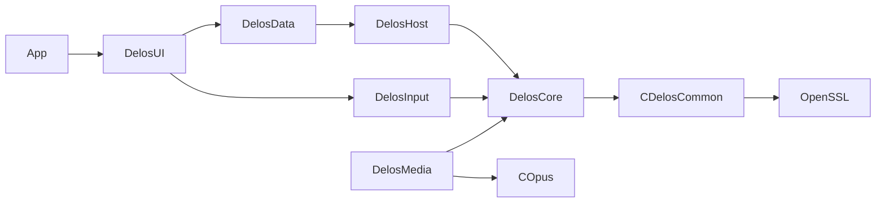

# Architecture

## Purpose

How DELOS for Apple is divided into modules, which way they may depend on each other, and where each part of the app
belongs.

## Modules

The app target (`App/`) only starts the interface. All code is in the Swift package `Packages/DelosKit`:

| Module | Contents | May import SwiftUI |
|---|---|---|
| `DelosUI` | Design tokens, fonts, icons, shaders, components, the focus engine, the screens | Yes |
| `DelosData` | Stored data: hosts, profiles, settings, playtime, artwork | No |
| `DelosHost` | Discovery, pairing, the HTTPS client of the host | No |
| `DelosCore` | The C streaming core `delos-common-c` (C target `CDelosCommon`) and its Swift wrapper | No |
| `DelosMedia` | Video decoding and rendering, audio; Opus decoding (C target `COpus`) | No |
| `DelosInput` | Controllers, keyboard, touch, rumble, motion | No |

Modules that are still empty contain one file that names their phase.

Every module is compiled in the Swift 6 language mode with warnings as errors.

## The stage

Sizes in the specification of DELOS for Android are pixels of a 1920 × 1080 stage. `Stage` is the port of Android's
`StagePlanner`: it scales the stage to the window by the axis with less room (the other axis gets more stage pixels),
but one stage pixel is never smaller than 0.43 points, the size it has on the AYN Odin 2 Portal where DELOS was
designed. An iPhone in landscape (932 × 430 points) is therefore a 2167 × 1000 stage at the floor, not a smaller copy
of 1920 × 1080; an iPad is a taller stage (1920 × 1440 at 4:3). `StageShape` (wide, standard, tall, compact) names the
layout family, and `Stage.safe` holds the safe area in stage pixels: the window fills the screen, and content anchored
to an edge keeps clear of the safe area itself. Views read the stage from the environment and write sizes as
`stage.px(26)`.

## Focus

On tvOS the system focus engine moves the focus. On iPhone, iPad and Mac a game controller does not drive SwiftUI's
focus, so `MenuInput` (DelosInput) turns the D-pad, the left stick, A, B and the arrow, Return and Escape keys into
commands, and `FocusModel` (DelosUI) moves the focus to the nearest item in the pressed direction (`FocusGeometry`).
`FocusItem` wraps a view for both engines.

## Video formats

`DelosMedia` turns what the host sends into what VideoToolbox decodes, without FFmpeg:

| Codec | Stream from the host | Format description | Sample data |
|---|---|---|---|
| H.264 | Annex B NAL units | from SPS and PPS | length-prefixed NAL units without parameter sets |
| HEVC | Annex B NAL units | from VPS, SPS and PPS | the same |
| AV1 | low-overhead OBUs | from the sequence header: `av1C` record, bit depth, range and color (BT.709, BT.2020 with PQ or HLG) | the OBUs unchanged |

`AV1.parseSequenceHeader` reads the sequence header (AV1 specification, section 5.5) with `BitReader`.

`VideoSamples` keeps the format description of the running stream (replaced when a key frame brings different
parameter sets) and wraps each frame in a sample buffer marked "display immediately", since the host paces the stream;
a frame before the first key frame fails with `needsKeyFrame`, the signal to ask the host for one. `VideoRenderer` is the
renderer interface; `DisplayLayerRenderer` shows the samples through `AVSampleBufferDisplayLayer` (decision L4).

## Sounds and haptics

`Feedback` plays the five interface sounds of DELOS for Android (move, select, back, open, error) as system sounds, so
they mix with other audio and follow the silent switch, and on iPhone and iPad a matching system haptic.
Moving the focus plays move, activating an item plays select.

## Backgrounds

`Backdrop(kind:)` draws every background of DELOS for Android (`BackgroundKind`), ported from `AnimatedBackground` in
`shell/ui/Backdrop.kt` and the AGSL sources in `shell/ui/BackgroundShaders.kt`. As there, the theme color lies at the
bottom; over it a layer with the base gradient (`hsl(base, 40, 8)` → `hsl(base, 38, 5)` dark, `hsl(base, 45, 96)` →
`hsl(base, 38, 90)` light) and the background, blended with "screen" in the dark theme. Everything is drawn on the
prototype's 960 × 540 canvas, scaled uniformly and extended along the longer axis (`BackgroundParams.canvas(for:)`).
The clock runs at 0.96 per second, 0.15 of that with reduced motion. `BackgroundParams` is Android's `BgParams`
(hues, saturations, `s()`) with `lights()`, the three colors of the shader backgrounds.

| Kind | Android | Apple |
|---|---|---|
| Aurora, Tide, Silk | `drawAurora`, `drawTide`, `drawSilk` on the Compose canvas | `CanvasBackgrounds` on a SwiftUI `Canvas`, same shapes, colors and alphas; plus-lighter (Android: Plus) in the dark theme |
| Contour | AGSL `CONTOUR` and the radial glow in `drawContour` | `Contour.metal` and a `RadialGradient` |
| Nebula, Plasma, Lava, Caustics, Bokeh, Orbit | AGSL with the shared `PRELUDE` (`hash`, `noise`, `fbm`, `tri`, `pick`, `emit`) | `Backgrounds.metal`, `[[stitchable]]` color effects; glow 0.62 dark / 0.5 light, plus-lighter dark / normal light |
| Still | the base gradient | the base gradient |

The Metal ports differ from the AGSL text only where Metal must: GLSL's `mod()` is written out (`x - y * floor(x / y)`,
Metal's `fmod` keeps the sign of `x`), `atan` is `atan2`, the hash uses `precise::sin` (large arguments), and Orbit's
`pow(d, 2.0)` of a negative `d` is `d * d`. Tide always samples its waves at the right edge too: Android stops at the
last multiple of 12 pixels, which is the edge only at 16:9, and on a wider screen the waves would slope down to the
corner. The fallback of Android below version 13 (Aurora in place of a shader) is not needed. The focused game's colors
(`clock.tints`) and the game background are not ported yet; Material You has no
counterpart. In debug builds `-DelosBackground <kind>` and `-DelosTheme light` pick the background and the theme
([BUILDING.md](BUILDING.md)).

## Settings

`Appearance` (DelosData) holds Settings → Appearance with the defaults of DELOS for Android. `AppearanceStore` keeps one
per profile in `UserDefaults`; reading is lenient, so an unknown option falls back to its default without losing the
other settings.

## Strings

User-visible text comes from DELOS for Android's string resources, so both apps say the same thing in the same ten
languages. `tools/l10n/keys.txt` lists the names the Apple app uses; `tools/l10n/import_android.py <Android checkout>`
copies them with every translation into `DelosUI/Resources/Localizable.xcstrings` (placeholders converted to Apple's
format, plurals as plural variations). Swift reads them with `L("name")`; `tools/l10n/check_usage.py` (part of
`tools/test.sh`) fails when a used name is missing or lacks a language. `App/Shared/InfoPlist.xcstrings` gives the app
bundle the same ten languages; without it iOS shows the package's strings in English only.

## The streaming core

### C sources

The C code comes from two submodules: `ThirdParty/delos-common-c` (the DELOS core, shared with DELOS for Android,
with its own submodules `enet` and `nanors`) and `ThirdParty/opus` (libopus at a release tag). SwiftPM builds only
files inside the package directory, so each C target directory holds a relative symlink to its submodule:

| Target | Symlink | Built files | Settings |
|---|---|---|---|
| `CDelosCommon` | `Sources/CDelosCommon/core` → `ThirdParty/delos-common-c` | `src/*.c`, the Unix files of `enet`, `nanors/rs.c` and `oblas_*`, as in the core's `CMakeLists.txt`; plus `DelosLog.c` | `HAS_SOCKLEN_T`, `__APPLE_USE_RFC_3542`; `LC_DEBUG` in debug, `NDEBUG` in release, as in Moonlight's `moonlight-common.xcodeproj`; OpenSSL from `OpenSSL-Package` |
| `COpus` | `Sources/COpus/opus` → `ThirdParty/opus` | the lists of `opus_sources.mk`, `celt_sources.mk` and `silk_sources.mk` for a floating-point build | `config/config.h` replaces the generated configuration; NEON intrinsics are presumed on arm64 (`neon/` compiles the NEON files on arm64 only, because SwiftPM cannot select files by architecture) |

`include/` of each target has the umbrella header of its Clang module. The only C written for DELOS is `DelosLog.c`:
the core logs through a variadic callback, which Swift cannot define, so it formats the message and hands a plain
string to Swift. Apple's toolchain warns about 64-to-32-bit conversions in the third-party code; the targets switch
that warning off instead of changing the submodules.

### Swift wrapper

`StreamConfiguration` and `ServerInformation` map to the core's `STREAM_CONFIGURATION` and `SERVER_INFORMATION`; the
bit sets `VideoFormats`, `ServerCodecModes` and `EncryptionFlags` carry the core's constants, and the PyroWave fields
are carried for parity with Android but unused. `StreamSession` (an actor) runs one connection: `start` runs the
blocking `LiStartConnection` on its own thread and throws `StreamError` with the failing stage, `stop` runs
`LiStopConnection`, and `events` is an `AsyncStream` of stage progress, connection status, termination, rumble, LEDs,
motion and trigger requests. Video decode units and audio packets go to `Sendable` sinks (`VideoDecodeUnitSink`,
`AudioSampleSink`); a `DecodeUnit` is non-copyable and borrowed, so the core's memory cannot outlive the call. Input
(`sendController`, mouse, keyboard, text, scroll, touch) and statistics are `nonisolated` and call the core directly.

The core keeps its connection in global state and its callbacks get no context pointer. So one global `CoreContext`
(`CoreBridge`, behind a `Mutex`) connects the callbacks to the session that holds the core; a second session cannot
start while one is active. The callbacks run on the core's threads.

`OpusMultistreamDecoder` (DelosMedia) decodes the host's multistream packets to interleaved float samples and conceals
lost packets.

## Verification

- `swift test` in `Packages/DelosKit`: colors against an independent HSL implementation, focus geometry and model,
  stage scaling, controller stick and key mapping, the background lights and saturations against the Kotlin formulas,
  and that every background shader is in the Metal library; the stream configuration and server information against the C
  structures, the audio, video format and codec bits against the protocol values, the C callbacks against events and
  sinks, input without a stream, a start against a closed local port (fails in the RTSP handshake with
  `ECONNREFUSED` after the core's 10-second retry), `stop()` and task cancellation during that retry (the start ends
  within a second), an invalid configuration, Opus encode → decode of stereo sweeps (2.5 ms delay, both channels
  above 15 dB SNR), packet loss concealment, 5.1 layout, invalid layouts and packets.
- `xcodebuild -scheme DelosCore` and `-scheme DelosMedia` for `generic/platform=iOS`, `tvOS`, `macOS` and the iOS and
  tvOS simulators.
- `sh tools/sim.sh iphone|ipad|tv`: the start screen in the simulators.
- DelosMediaTests decode the first frame of an H.264, an HEVC and an 8-bit and a 10-bit AV1 stream with VideoToolbox on
  the Mac (AV1 is skipped where the Mac has no hardware AV1 decoder; the M6 used on 2026-11-16 has one).
- The start screen in Czech in the iPhone simulator (`-AppleLanguages (cs)`).
- Every background in the iPhone simulator (dark theme; Contour, Nebula and Aurora also light), compared with the
  Android code; Nebula, Lava and Orbit also against a NumPy reimplementation of their AGSL at the same clock.
- `python3 -m unittest discover -s tools/l10n`: placeholder and escape conversion, the usage check.

### Not verified

- Moving the focus with a real game controller on iPhone and iPad (the simulator has no controller); the logic is
  covered by the unit tests only.
- GPU cost of the backgrounds (the shaders and the canvas ones) on a device.
- How the sounds and haptics feel on a device.
- A real stream: start, video and audio sinks with real data, input, statistics and termination against a host. The
  owner runs streams; P4 connects the sinks.
- libopus on x86_64 (Intel Macs and simulators) was only compiled; the tests ran on arm64, where the NEON paths are
  used.
